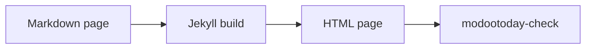

# キッチンシンク

テーマが提供するすべてのコンポーネントを、すべてのバリエーションで表示します。同じファイルを github.com で開くとフォールバックの表示を確認できます。コンポーネントは[コンポーネント](../)のページと同じく、用途ごとにまとめてから A-Z 順に並べます。各コンポーネントの役割と書き方はそのページにあり、このページは表示だけを示します。日本語の折り返し確認用の長い文: いろはにほへとちりぬるをわかよたれそつねならむうゐのおくやまけふこえてあさきゆめみしゑひもせす。

- 普通の Markdown
- github.com でも読める
- WCAG 2.2 AA

[主なアクション](#) [二番目](#) [三番目のリンク](#)

> [!NOTE]
> このページは[英語の原文](../../../components/kitchen-sink/)の翻訳です。内容が異なる場合は英語版が優先されます。

## テキストとインライン

本文のテキストと、段落の中の短い要素に使うスタイルです。

## バッジ

インラインのバッジ: `status:available` `status:partial` `status:planned`

タグのバッジ: `tag:beta` `tag:experimental`

| 機能 | ステータス |
|---|---|
| アラート | `status:available` |
| タブ | `status:partial` |
| 検索 | `status:planned` |

## キーボードのキー

`kbd:Ctrl+K` か、`kbd:/` だけで検索を開きます。`kbd:Cmd+C` でコピーします。

## リスト

2 つのリストスタイル: リンクのチップと見出し付きの項目。

- [インストール](../../guides/install/)
- [設定](../../guides/configuration/)
- [アクセシビリティ](../../guides/accessibility/)

タイトル付きの項目:

- **チップ**: リンクだけのリスト
- **タイトル付き項目**: 太字のタイトル、コロン、続いてテキスト

## 読み込み表示とスケルトン

スピナー、上部のバー、プレースホルダー。

`loading:spinner`

`skeleton:avatar`
`skeleton:text`
`skeleton:card`

## 進捗

値も文字で示す進捗バー。

翻訳 `progress:60`

## タイポグラフィ

**太字**、*斜体*、~~取り消し線~~、`code`、[コンポーネント一覧](../)へのリンクを含む段落です。脚注も使えます。[^1]

### 見出しレベル 3

#### 見出しレベル 4

1. 番号付きの項目
2. 番号付きの項目
   - 入れ子の箇条書き
   - 入れ子の箇条書き

- [x] 完了したタスク
- [ ] 未完了のタスク

> アラートではない普通の引用です。

---

区切り線の後のテキストです。

[^1]: 脚注です。

## ブロック

段落と段落の間に単独で置くブロックです。

## アラート

> [!NOTE]
> 流し読みでも知っておくべき有用な情報です。

> [!TIP]
> より良く、より簡単に進めるための助言です。

> [!IMPORTANT]
> 目的を達成するために知っておくべき重要な情報です。

> [!WARNING]
> 問題を避けるためにすぐ注意が必要な緊急の情報です。

> [!CAUTION]
> 特定の操作のリスクや悪い結果について注意を促します。

> [!NOTE]
> 内容の多いアラート:
>
> - `inline code` を含むリスト項目
> - [コンポーネント一覧](../)へのリンクを含む二つ目の項目
>
> ```sh
> echo "code inside an alert"
> ```

## コードブロック

インラインの `code`、フェンスブロック、スクロールする長い行:

```ruby
# frozen_string_literal: true
Jekyll::Hooks.register :site, :post_write do |site|
  puts "Built #{site.pages.size} pages into #{site.dest} with a deliberately long line to test horizontal scrolling"
end
```

```diff
- theme: minima
+ theme: jekyll-theme-modootoday
```

## コードのタイトルと diff

タイトル付きのコードブロックと diff。

`file:_config.yml`

```yaml
theme: jekyll-theme-modootoday
```

```diff
- remote_theme: old/theme
+ theme: jekyll-theme-modootoday
```

## ファイルツリー

小さなプロジェクトのツリー。

- docs
  - _config.yml
  - index.md
  - ko
    - index.md

## 引用

出典付きの引用。

> ドキュメントが github.com でもサイトでも読みやすい。
>
> — テーマの利用者

## メディア

画像、図、ダイアグラム、埋め込みフレーム、ウィジェットです。

## 埋め込み

遅延読み込みの埋め込み。

`embed:https://modootoday.github.io/jekyll-theme-modootoday/assets/images/sample.svg サンプルページの図`

## 図


*画像だけの段落の後に強調だけの段落が続くと、キャプション付きの図になります。*

front matter の `diagrams:` に並べた ```` ```mermaid ```` フェンスは静的な図になり、ソースはその下の開閉要素に入ります。



## ギャラリー

3 つのサムネイル。

- 
- 
- 
- 
- 
- 

## ウィジェット

代替テキスト付きのデモのカウンター要素。

## データ

表とグラフ、そしてそれらを読みやすくする機能です。

## グラフ

下の表から描いた棒グラフ。

`chart:bar stacked`

| 四半期 | ドキュメント | ブログ |
|---|---|---|
| 第 1 四半期 | 4,160 | 2,030 |
| 第 2 四半期 | 5,270 | 2,770 |
| 第 3 四半期 | 5,910 | 3,120 |
| 第 4 四半期 | 6,480 | 3,550 |

*四半期ごとの訪問数（積み上げ）*

## データファイルのグラフ

データファイルから描いた折れ線グラフ。

*1 月から 6 月までの月別訪問数*

## パラメーター表

カードのグリッドのオプション。

| 名前 | 型 | 既定値 | 説明 |
|---|---|---|---|
| `title` | 文字列 | `required` | ページタイトル |
| `cols` | 数値 | 2 | カードの列数 |

## 表

| キー | 型 | 既定値 | 説明 |
|---|---|---|---|
| `badges` | boolean | `true` | ステータスのコードスパンをバッジに変換する |
| `color_scheme` | string | `auto` | OS に合わせるか、配色を固定する |
| `components` | list | すべてのコアコンポーネント | ブラウザーに配信する CSS と JavaScript を絞る |
| `tokens` | map | テーマの既定値 | 主色、角丸、フォントスタックなどのデザイントークンを上書きする |

| 左 | 中央 | 右 |
|:---|:---:|---:|
| a | b | 1 |
| 長めのセル | 中央揃え | 1,000 |

## 開閉と順序

必要なときに開く内容と、順に読む内容です。

## アコーディオン

### キッチンシンクは何のためにありますか?

すべてのコンポーネントを 1 か所で見せるので、見た目の回帰に気づきやすくなります。

### JavaScript なしでも動きますか?

はい。JavaScript がなければ、すべての答えが質問の下に表示されたままになります。

### 答えにコードを入れられますか?

```sh
bundle exec jekyll serve
```

## 詳細

2 つの開閉要素。

### 何が必要ですか？

ブラウザーだけです。

## よくある質問

2 つの質問。

### テーマは無料ですか？

はい、MIT ライセンスです。

### GitHub Pages で動きますか？

はい、github-pages gem で動きます。

## ステップ

1. `_config.yml` にテーマを追加します。
2. プレーンな Markdown で `index.md` を書きます。
3. `bundle exec jekyll build` を実行します。
4. `modootoday-check` で結果を確認します。

## 見出しで書くステップ

### インストール

`remote_theme` とプラグインを追加します。

### 執筆

front matter 付きのページを作ります。

### 公開

`main` にプッシュして GitHub Pages を有効にします。

## パネルが二つのタブ

### macOS

```sh
brew install ruby
gem install jekyll bundler
```

### Linux

```sh
sudo apt install ruby-full
gem install jekyll bundler
```

## パネルが多いタブ

### Ruby

```ruby
puts "Hello"
```

### JavaScript

```js
console.log("Hello");
```

### Python

```python
print("Hello")
```

### Shell

```sh
echo Hello
```

### 名前がずっと長いタブ

```yaml
greeting: Hello
```

## タイムライン

### インストール

アラート、セクション、カード、タブ、ステータスバッジ、チェッカー。

### 書く

デザイントークン、`modootoday:` ブロック、ナビゲーション、コードのコピー。

### 確認

テーマ切り替え、パンくずリスト、目次、アコーディオン、ステップ、図。

### 公開

タイムライン、キーボードのキー、クライアント検索、post レイアウト。

## リスト形式のタイムライン

1. インストール: アラート、セクション、カード、タブ。
2. 書く: デザイントークン、ナビゲーション。
3. 確認: テーマ切り替え、目次、ステップ。

## ページセクション

`sections:` の項目とヒーローでランディングページを組み立てる帯です。

## 2 列のカード

- **短い** — 1 行。
- **長めのカード** — 説明が長く数行に折り返すカードで、グリッド全体の余白、行の高さ、揃えを確認します。
- **バッジ付き** — カードにステータスを付けられます。 `status:available`
- **リンク付き** — [インストールガイド](../../guides/install/)を読んでください。

## 3 列のカード

- **アラート** — 5 種類の GitHub アラート。 `status:available`
- **タブ** — アクセシブルなインストールタブ。 `status:partial`
- **検索** — 予定項目の例。 `status:planned`
- **トークン** — 色、角丸、フォント。 `status:available`
- **Sass** — コンポーネントごとに一つのパーシャル。 `status:available`
- **Markdown 版** — エージェント向けの Markdown。 `status:available`

## 4 列のカード

- **アラート** — 5 種類の GitHub アラート。 `status:available`
- **タブ** — アクセシブルなインストールタブ。 `status:partial`
- **検索** — 予定項目の例。 `status:planned`
- **トークン** — 色、角丸、フォント。 `status:available`
- **Sass** — コンポーネントごとに一つのパーシャル。 `status:available`
- **Markdown 版** — エージェント向けの Markdown。 `status:available`
- **グリッド** — 幅が 67rem 以上のセクションでは 4 列、本文の列では 2×2。
- **行** — 8 枚のカードがどの行も埋めます。

## ボタン

[はじめる](../../guides/install/) [ルールを読む](https://github.com/modootoday/jekyll-theme-modootoday/blob/main/RULES.md)

## インストール

このドキュメントをホーム画面に置き、オフラインでも読めます。

## リンクカード

2 枚のリンクカード。

- [インストール](../../guides/install/) — サイトにテーマを追加します。
- [設定](../../guides/configuration/) — すべての設定を一か所で確認します。

## 料金プラン

3 つのプラン。2 つ目がおすすめです。

### 無料

**$0**

- サイト 1 つ

[始める](#)

### チーム

**$12**

- サイト 10 個
- サポート

[チームを選ぶ](#)

## 分割

片側にテキスト、もう片側に画像が来ます。

## コード付きの分割

キットをインストールし、ビルドのたびに検査ツールを実行します。

`file:terminal`

```sh
bundle add jekyll-theme-modootoday
bundle exec modootoday-check . _site
```

## 購読

リリースのたびにメールを 1 通受け取れます。
