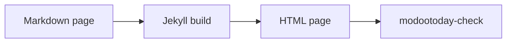

# 키친싱크

테마가 제공하는 모든 컴포넌트를 모든 변형으로 보여 줍니다. 같은 파일을 github.com에서 열면 기본 렌더링 모습을 볼 수 있습니다. 컴포넌트는 [컴포넌트](../) 페이지와 같은 순서로, 용도별로 묶은 뒤 A-Z로 놓습니다. 각 컴포넌트가 하는 일과 쓰는 법은 그 페이지에 있고, 이 페이지는 보여 주기만 합니다. 한국어 줄바꿈 확인용 긴 문장: 가나다라마바사아자차카타파하가나다라마바사아자차카타파하.

- 평범한 Markdown
- github.com에서도 읽힘
- WCAG 2.2 AA

[주요 동작](#) [보조](#) [세 번째 링크](#)

> [!NOTE]
> 이 페이지는 [영어 원문](../../components/kitchen-sink/)의 번역입니다. 내용이 다르면 영어 문서가 우선합니다.

## 텍스트와 인라인

본문 텍스트와 문단 안의 짧은 표시에 쓰는 스타일입니다.

## 배지

인라인 배지: `status:available` `status:partial` `status:planned`

태그 배지: `tag:beta` `tag:experimental`

| 기능 | 상태 |
|---|---|
| 알림 | `status:available` |
| 탭 | `status:partial` |
| 검색 | `status:planned` |

## 키보드 키

`kbd:Ctrl+K`나 `kbd:/`만 눌러도 검색이 열립니다. 복사는 `kbd:Cmd+C`입니다.

## 목록

목록 스타일 두 가지: 링크 칩과 제목 있는 항목.

- [설치](../../guides/install/)
- [설정](../../guides/configuration/)
- [접근성](../../guides/accessibility/)

제목이 있는 항목:

- **칩**: 링크만 있는 목록
- **제목 항목**: 굵은 제목, 콜론, 그다음 텍스트

## 로딩과 스켈레톤

스피너, 상단 막대, 자리 표시자.

`loading:spinner`

`skeleton:avatar`
`skeleton:text`
`skeleton:card`

## 진행률

값을 글자로도 보여 주는 진행 막대.

번역 `progress:60`

## 타이포그래피

**굵게**, *기울임*, ~~취소선~~, `code`, [컴포넌트 목록](../) 링크가 있는 문단입니다. 각주도 쓸 수 있습니다.[^1]

### 3단계 제목

#### 4단계 제목

1. 번호 항목
2. 번호 항목
   - 중첩 항목
   - 중첩 항목

- [x] 완료한 작업
- [ ] 남은 작업

> 알림이 아닌 일반 인용문입니다.

---

구분선 다음의 글입니다.

[^1]: 각주입니다.

## 블록

문단 사이에 단독으로 놓이는 블록입니다.

## 알림

> [!NOTE]
> 훑어보더라도 꼭 알아야 할 유용한 정보입니다.

> [!TIP]
> 더 쉽고 낫게 하는 데 도움이 되는 조언입니다.

> [!IMPORTANT]
> 목표를 이루려면 반드시 알아야 할 핵심 정보입니다.

> [!WARNING]
> 문제를 막으려면 바로 확인해야 하는 긴급한 정보입니다.

> [!CAUTION]
> 특정 동작의 위험이나 나쁜 결과를 경고합니다.

> [!NOTE]
> 내용이 많은 알림:
>
> - `inline code`가 들어간 목록 항목
> - [컴포넌트 목록](../) 링크가 있는 두 번째 항목
>
> ```sh
> echo "code inside an alert"
> ```

## 코드 블록

인라인 `code`, 펜스 코드 블록, 가로로 스크롤되는 긴 줄:

```ruby
# frozen_string_literal: true
Jekyll::Hooks.register :site, :post_write do |site|
  puts "Built #{site.pages.size} pages into #{site.dest} with a deliberately long line to test horizontal scrolling"
end
```

```diff
- theme: minima
+ theme: jekyll-theme-modootoday
```

## 코드 제목과 diff

제목 있는 코드 블록과 diff.

`file:_config.yml`

```yaml
theme: jekyll-theme-modootoday
```

```diff
- remote_theme: old/theme
+ theme: jekyll-theme-modootoday
```

## 파일 트리

작은 프로젝트 트리.

- docs
  - _config.yml
  - index.md
  - ko
    - index.md

## 인용

출처가 붙은 인용.

> 문서가 github.com에서도 사이트에서도 잘 읽힙니다.
>
> — 테마 사용자

## 미디어

이미지, 그림, 다이어그램, 임베드 프레임, 위젯입니다.

## 임베드

지연 로딩되는 임베드.

`embed:https://modootoday.github.io/jekyll-theme-modootoday/assets/images/sample.svg 샘플 페이지 그림`

## 그림


*이미지만 있는 문단 뒤에 강조만 있는 문단이 오면 캡션이 달린 그림이 됩니다.*

front matter `diagrams:`에 나열한 ```` ```mermaid ```` 펜스는 정적 그림이 되고, 원본은 그 아래 펼침 요소에 들어갑니다.



## 갤러리

썸네일 세 개.

- 
- 
- 
- 
- 
- 

## 위젯

대체 텍스트가 있는 데모 카운터 요소.

## 데이터

표와 차트, 그리고 이를 읽기 쉽게 돕는 도구입니다.

## 차트

아래 표로 그린 막대 차트.

`chart:bar stacked`

| 분기 | 문서 | 블로그 |
|---|---|---|
| 1분기 | 4,160 | 2,030 |
| 2분기 | 5,270 | 2,770 |
| 3분기 | 5,910 | 3,120 |
| 4분기 | 6,480 | 3,550 |

*분기별 방문 수(누적)*

## 데이터 파일 차트

데이터 파일로 그린 선 차트.

*1월부터 6월까지 월별 방문 수*

## 매개변수 표

카드 격자의 옵션.

| 이름 | 유형 | 기본값 | 설명 |
|---|---|---|---|
| `title` | 문자열 | `required` | 페이지 제목 |
| `cols` | 숫자 | 2 | 카드 열 수 |

## 표

| 키 | 유형 | 기본값 | 설명 |
|---|---|---|---|
| `badges` | boolean | `true` | 상태 코드 스팬을 배지로 바꿈 |
| `color_scheme` | string | `auto` | 운영체제 설정을 따르거나 색 구성을 고정 |
| `components` | list | 모든 핵심 컴포넌트 | 브라우저로 보내는 CSS와 JavaScript를 줄임 |
| `tokens` | map | 테마 기본값 | 주 색상, 모서리 반경, 글꼴 스택 같은 디자인 토큰을 덮어씀 |

| 왼쪽 | 가운데 | 오른쪽 |
|:---|:---:|---:|
| a | b | 1 |
| 긴 셀 | 가운데 정렬 | 1,000 |

## 펼침과 순서

필요할 때 펼치거나 순서대로 읽는 내용입니다.

## 아코디언

### 키친싱크는 어디에 쓰나요?

모든 컴포넌트를 한곳에 모아 보여 주므로 화면이 깨진 곳을 쉽게 찾을 수 있습니다.

### JavaScript 없이도 동작하나요?

네. JavaScript가 없으면 모든 답이 질문 아래에 펼쳐진 채로 보입니다.

### 답에 코드를 넣을 수 있나요?

```sh
bundle exec jekyll serve
```

## 세부 정보

펼침 요소 두 개.

### 무엇이 필요한가요?

브라우저만 있으면 됩니다.

## 자주 묻는 질문

질문 두 개.

### 테마는 무료인가요?

네, MIT 라이선스입니다.

### GitHub Pages에서 동작하나요?

네, github-pages gem으로 동작합니다.

## 단계

1. `_config.yml`에 테마를 추가합니다.
2. 평범한 Markdown으로 `index.md`를 씁니다.
3. `bundle exec jekyll build`를 실행합니다.
4. `modootoday-check`로 결과를 확인합니다.

## 제목으로 쓰는 단계

### 설치

`remote_theme`과 플러그인을 추가합니다.

### 작성

front matter가 있는 페이지를 만듭니다.

### 배포

`main`에 푸시하고 GitHub Pages를 켭니다.

## 패널이 두 개인 탭

### macOS

```sh
brew install ruby
gem install jekyll bundler
```

### Linux

```sh
sudo apt install ruby-full
gem install jekyll bundler
```

## 패널이 많은 탭

### Ruby

```ruby
puts "Hello"
```

### JavaScript

```js
console.log("Hello");
```

### Python

```python
print("Hello")
```

### Shell

```sh
echo Hello
```

### 이름이 훨씬 긴 탭

```yaml
greeting: Hello
```

## 타임라인

### 설치

알림, 섹션, 카드, 탭, 상태 배지, 검사기.

### 작성

디자인 토큰, `modootoday:` 블록, 내비게이션, 코드 복사.

### 확인

테마 전환, 이동 경로, 목차, 아코디언, 단계, 그림.

### 배포

타임라인, 키보드 키, 클라이언트 검색, post 레이아웃.

## 목록으로 쓴 타임라인

1. 설치: 알림, 섹션, 카드, 탭.
2. 작성: 디자인 토큰, 내비게이션.
3. 확인: 테마 전환, 목차, 단계.

## 페이지 섹션

`sections:` 항목과 히어로로 랜딩 페이지를 구성하는 띠 영역입니다.

## 2열 카드

- **짧은 카드** — 한 줄.
- **긴 카드** — 설명이 길어 여러 줄로 넘어가는 카드로, 그리드 전체의 간격, 줄 높이, 정렬을 확인합니다.
- **배지 포함** — 카드에 상태를 표시할 수 있습니다. `status:available`
- **링크 포함** — [설치 안내](../../guides/install/)를 읽어 보세요.

## 3열 카드

- **알림** — GitHub 알림 다섯 종류. `status:available`
- **탭** — 접근성을 갖춘 설치 탭. `status:partial`
- **검색** — 계획된 항목의 예. `status:planned`
- **토큰** — 색상, 모서리 반경, 글꼴. `status:available`
- **Sass** — 컴포넌트마다 파셜 하나. `status:available`
- **Markdown 버전** — 에이전트용 Markdown. `status:available`

## 4열 카드

- **알림** — GitHub 알림 다섯 종류. `status:available`
- **탭** — 접근성을 갖춘 설치 탭. `status:partial`
- **검색** — 계획된 항목의 예. `status:planned`
- **토큰** — 색상, 모서리 반경, 글꼴. `status:available`
- **Sass** — 컴포넌트마다 파셜 하나. `status:available`
- **Markdown 버전** — 에이전트용 Markdown. `status:available`
- **그리드** — 폭이 67rem 이상인 섹션에서는 네 열, 본문 열에서는 2×2.
- **줄** — 카드 여덟 장이 모든 줄을 채웁니다.

## 버튼

[시작하기](../../guides/install/) [규칙 읽기](https://github.com/modootoday/jekyll-theme-modootoday/blob/main/RULES.md)

## 링크 카드

링크 카드 두 개.

- [설치](../../guides/install/) — 사이트에 테마를 추가합니다.
- [설정](../../guides/configuration/) — 모든 설정을 한곳에서 봅니다.

## 요금제

요금제 세 개. 두 번째를 추천합니다.

### 무료

**$0**

- 사이트 1개

[시작하기](#)

### 팀

**$12**

- 사이트 10개
- 지원

[팀 선택](#)

## 분할

한쪽에는 텍스트, 다른 쪽에는 그림이 옵니다.

## 코드 분할

키트를 설치한 뒤 빌드할 때마다 검사기를 실행합니다.

`file:terminal`

```sh
bundle add jekyll-theme-modootoday
bundle exec modootoday-check . _site
```

## 구독

릴리스가 나오면 이메일을 한 통 받으세요.
