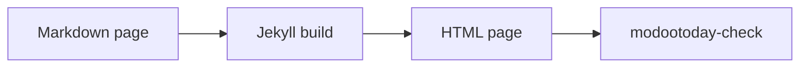

# Kitchen sink

Every component the theme ships, in every variant. The same file is readable on github.com, which shows the fallback. The components follow the order of the [Components](../) page: by purpose, then A-Z. That page says what each one does and how to write it; this one only shows them.

- Plain Markdown
- Reads on github.com
- WCAG 2.2 AA

[Primary action](#) [Secondary](#) [Third link](#)

## Text and inline

Styles for running text and for short marks inside a paragraph.

## Badges

Inline badges: `status:available` `status:partial` `status:planned`

Tag badges: `tag:beta` `tag:experimental`

| Feature | Status |
|---|---|
| Alerts | `status:available` |
| Tabs | `status:partial` |
| Search | `status:planned` |

## Heading anchors

Each heading on this page ends with a link to itself; hover over one, or press Tab until it shows.

### A heading one level down

The `###` headings get the link too.

## Keyboard keys

Open search with `kbd:Ctrl+K`, or `kbd:/` on its own. Copy with `kbd:Cmd+C`.

## Lists

Two list styles: link chips and titled items.

- [Install](../../guides/install/)
- [Configuration](../../guides/configuration/)
- [Accessibility](../../guides/accessibility/)

Items with a title:

- **Chips**: a list of links only
- **Titled items**: a bold title, a colon, then the text

## Loading and skeletons

A spinner, a top bar and placeholders.

`loading:spinner`

`skeleton:avatar`
`skeleton:text`
`skeleton:card`

## Progress

A progress bar with its value as text.

Translation `progress:60`

## Typography

Paragraph text with **bold**, *italic*, ~~strikethrough~~, `code` and a link to the [components index](../). Footnotes work too.[^1]

### Heading level 3

#### Heading level 4

1. Ordered item
2. Ordered item
   - nested bullet
   - nested bullet

- [x] task done
- [ ] task open

> A plain quote that is not an alert.

---

Text after a thematic break.

[^1]: A footnote.

## Blocks

Blocks that stand on their own between paragraphs.

## Alerts

> [!NOTE]
> Useful information that users should know, even when skimming.

> [!TIP]
> Helpful advice for doing things better or more easily.

> [!IMPORTANT]
> Key information users need to know to achieve their goal.

> [!WARNING]
> Urgent info that needs immediate user attention to avoid problems.

> [!CAUTION]
> Advises about risks or negative outcomes of certain actions.

> [!NOTE]
> An alert with more content:
>
> - a list item with `inline code`
> - a second item with a link to the [components index](../)
>
> ```sh
> echo "code inside an alert"
> ```

## Code blocks

Inline `code`, a fenced block and a long line that scrolls:

```ruby
# frozen_string_literal: true
Jekyll::Hooks.register :site, :post_write do |site|
  puts "Built #{site.pages.size} pages into #{site.dest} with a deliberately long line to test horizontal scrolling"
end
```

```diff
- theme: minima
+ theme: jekyll-theme-modootoday
```

## Code titles and diffs

A titled code block and a diff.

`file:_config.yml`

```yaml
theme: jekyll-theme-modootoday
```

```diff
- remote_theme: old/theme
+ theme: jekyll-theme-modootoday
```

## File tree

A small project tree.

- docs
  - _config.yml
  - index.md
  - ko
    - index.md

## Quote

A quote with its attribution.

> The docs read well on github.com and on the site.
>
> — A theme user

## Media

Images, figures, diagrams, embedded frames and widgets.

## Embeds

A lazy-loaded embed.

`embed:https://modootoday.github.io/jekyll-theme-modootoday/assets/images/sample.svg Sample page drawing`

## Figure


*An image-only paragraph followed by an emphasis-only paragraph becomes a figure with a caption.*

A ```` ```mermaid ```` fence listed in front matter `diagrams:` becomes a static figure, with its source in a disclosure below it.



## Gallery

Three thumbnails.

- 
- 
- 
- 
- 
- 

## Widget

A demo counter element with its fallback text.

## Data

Tables and charts, and the tools that help read them.

## Chart

A bar chart from the table below.

`chart:bar stacked`

| Quarter | Docs | Blog |
|---|---|---|
| Q1 | 4,160 | 2,030 |
| Q2 | 5,270 | 2,770 |
| Q3 | 5,910 | 3,120 |
| Q4 | 6,480 | 3,550 |

*Visits per quarter, stacked*

## Chart from a data file

A line chart from a data file.

*Monthly visits, January to June*

## Parameter table

Options of a card grid.

| Name | Type | Default | Description |
|---|---|---|---|
| `title` | string | `required` | Page title |
| `cols` | number | 2 | Card columns |

## Tables

| Key | Type | Default | Description |
|---|---|---|---|
| `badges` | boolean | `true` | Convert status code spans into badges |
| `color_scheme` | string | `auto` | Follow the operating system or force a scheme |
| `components` | list | all core components | Limit the CSS and JavaScript that are shipped to the browser |
| `tokens` | map | theme defaults | Override design tokens such as primary color, radius and font stacks |

| Left | Center | Right |
|:---|:---:|---:|
| a | b | 1 |
| longer cell | centered | 1,000 |

## Disclosure and sequence

Content that opens on request or reads in order.

## Accordion

### What is the kitchen sink for?

It shows every component in one place, so visual regressions are easy to spot.

### Does it work without JavaScript?

Yes. Without JavaScript every answer stays visible under its question.

### Can an answer hold code?

```sh
bundle exec jekyll serve
```

## Details

Two disclosures.

### What does it need?

Nothing but the browser.

## FAQ

Two questions.

### Is the theme free?

Yes, under the MIT license.

### Does it run on GitHub Pages?

Yes, with the github-pages gem.

## Steps

1. Add the theme to `_config.yml`.
2. Write `index.md` in plain Markdown.
3. Run `bundle exec jekyll build`.
4. Check the result with `modootoday-check`.

## Steps as headings

### Install

Add `remote_theme` and the plugin.

### Write

Create a page with front matter.

### Publish

Push to `main` and turn on GitHub Pages.

## Tabs with many panels

### Ruby

```ruby
puts "Hello"
```

### JavaScript

```js
console.log("Hello");
```

### Python

```python
print("Hello")
```

### Shell

```sh
echo Hello
```

### A tab with a much longer name

```yaml
greeting: Hello
```

## Tabs with two panels

### macOS

```sh
brew install ruby
gem install jekyll bundler
```

### Linux

```sh
sudo apt install ruby-full
gem install jekyll bundler
```

## Timeline

### Install

Alerts, sections, cards, tabs, status badges and the checker.

### Write

Design tokens, the `modootoday:` block, navigation and code copy.

### Check

Theme toggle, breadcrumb, table of contents, accordion, steps and figures.

### Publish

Timeline, keyboard keys, client search and the post layout.

## Timeline as a list

1. Install: alerts, sections, cards and tabs.
2. Write: design tokens and navigation.
3. Check: theme toggle, table of contents and steps.

## Page sections

Bands that build a landing page from `sections:` items and the hero.

## Buttons

[Get started](../../guides/install/) [Read the rules](https://github.com/modootoday/jekyll-theme-modootoday/blob/main/RULES.md)

## Cards in 2 columns

- **Short** — One line.
- **Longer card** — A card with a longer description that wraps over several lines to check spacing, line height and alignment across the grid.
- **With a badge** — Cards can carry status. `status:available`
- **With a link** — Read the [install guide](../../guides/install/).

## Cards in 3 columns

- **Alerts** — Five GitHub alert types. `status:available`
- **Tabs** — Accessible install tabs. `status:partial`
- **Search** — Example of a planned item. `status:planned`
- **Tokens** — Colors, radius and fonts. `status:available`
- **Sass** — One partial per component. `status:available`
- **Twins** — Markdown for agents. `status:available`

## Cards in 4 columns

- **Alerts** — Five GitHub alert types. `status:available`
- **Tabs** — Accessible install tabs. `status:partial`
- **Search** — Example of a planned item. `status:planned`
- **Tokens** — Colors, radius and fonts. `status:available`
- **Sass** — One partial per component. `status:available`
- **Twins** — Markdown for agents. `status:available`
- **Grid** — Four across in a section 67rem wide or more, two by two in a text column.
- **Rows** — Eight cards fill every row.

## Install

Keep these docs on your home screen and read them offline.

## Link cards

Two link cards.

- [Install](../../guides/install/) — Add the theme to a site.
- [Configuration](../../guides/configuration/) — Every setting in one place.

## Pricing

Three plans; the second is recommended.

### Free

**$0**

- One site

[Start the Free plan](#)

### Team

**$12**

- Ten sites
- Support

[Choose Team](#)

## Split

Text on one side, the picture on the other.

## Split with code

Install the kit, then run the checker before each build.

`file:terminal`

```sh
bundle add jekyll-theme-modootoday
bundle exec modootoday-check . _site
```

## Subscribe

Get one email when a release ships.
