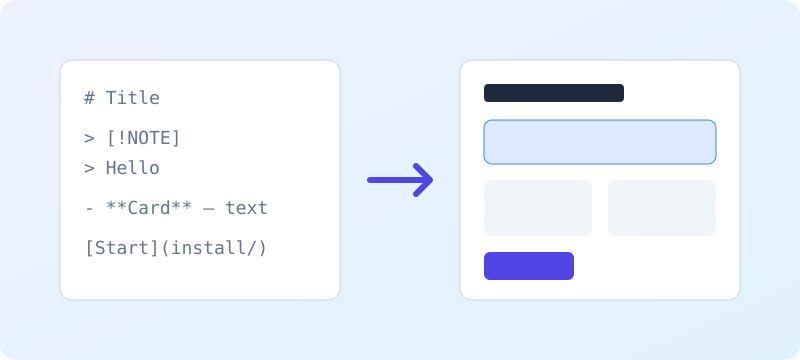

# 컴포넌트

모든 컴포넌트는 평범한 Markdown이에요. 아래 예시마다 Markdown 소스와, 같은 소스로 테마가 그려 낸 실제 결과를 이어서 보여 줘요. 결과는 지금 쓰는 라이트·다크 모드 그대로예요. 소스 블록을 복사해 붙이면 같은 결과를 얻어요. github.com에서는 기본 요소로 보여요.

[키친싱크 열기](kitchen-sink/) [설정](../configuration/)

> [!NOTE]
> 이 페이지는 [영어 원문](../../components/)의 번역이에요. 내용이 다르면 영어 문서가 우선해요.

## 알림

`status:available` GitHub 알림이 언어에 맞는 제목이 붙은 콜아웃이 돼요. 종류는 note, tip, important, warning, caution 다섯 가지예요. 스크린 리더는 각각을 노트(`role="note"`)로 읽어요.

> [!NOTE]
> Useful information that users should know, even when skimming.

> [!TIP]
> Helpful advice for doing things better or more easily.

> [!IMPORTANT]
> Key information users need to know to achieve their goal.

> [!WARNING]
> Urgent info that needs immediate user attention to avoid problems.

> [!CAUTION]
> Advises about risks or negative outcomes of certain actions.

## 내용이 있는 알림

알림 안에 목록과 코드를 넣을 수 있어요. 표시가 있는 줄에는 다른 글자를 쓰지 마세요.

> [!TIP]
> Before you publish:
>
> - run `modootoday-check`
> - preview with `bundle exec jekyll serve`

## 카드

`status:available` `c: features` 섹션에서 **굵은 글씨**로 시작하는 목록 항목이 카드가 돼요. `cols: 2`나 `cols: 3`으로 열 수를 정하고, 좁은 화면에서는 한 열로 보여요.

- **Plain Markdown** — Pages read well on github.com too.
- **With a badge** — Cards can carry status. `status:available`

## 3열 카드

같은 목록을 `cols: 3`으로 쓴 예예요.

- **Alerts** — Five alert types.
- **Tabs** — Accessible code tabs.
- **Search** — Client-side search.

## 버튼

`status:available` 링크만 있는 문단이 버튼이 되고, 첫 링크가 주 버튼이에요. 히어로(첫 `##` 앞)와 `c: cta` 섹션에서 동작해요.

[Get started](../install/) [Read the configuration](../configuration/)

## 탭

`status:available` `c: tabs` 섹션에서 `###` 제목과 바로 뒤 코드 블록이 탭 하나가 돼요. 두 개 이상 쓰세요. 방향키로 탭을 옮기고 Home·End로 처음과 끝으로 가요. JavaScript가 없으면 모든 블록이 제목 아래에 그대로 보여요.

### macOS

```sh
brew install ruby
```

### Linux

```sh
sudo apt install ruby-full
```

## 배지

`status:available` 정해진 접두어가 붙은 코드 스팬이 배지가 돼요. status(available, partial, planned)와 tag가 있어요. 상태 기호는 스크린 리더에서 숨기고 이름을 읽어요.

`status:available` `status:partial` `status:planned`

`tag:beta`

## 키보드 키

`status:available` kbd와 콜론으로 시작하는 코드 스팬이 키보드 키가 돼요. 키는 공백 없이 `+`로 이어요.

Open search with `kbd:Ctrl+K`, or press `kbd:/`.

## 아코디언

`status:available` `c: accordion` 섹션에서 `###` 제목이 아래 내용을 펼치고 접는 버튼(`aria-expanded`)이 돼요. Enter나 Space로 전환해요. JavaScript가 없으면 모든 답이 보여요.

### Does it work without JavaScript?

Yes. Every answer stays visible under its question.

### Can an answer hold code?

```sh
bundle exec jekyll serve
```

## 단계

`status:available` `c: steps` 섹션에서 번호 목록이 번호 붙은 단계가 돼요.

1. Add the theme to `_config.yml`.
2. Write `index.md` in plain Markdown.
3. Run `bundle exec jekyll build`.

## 제목으로 쓰는 단계

단계 하나에 여러 줄이 필요하면 목록 대신 `###` 제목을 쓰세요.

### Install

Add `remote_theme` and the plugin.

### Publish

Push to `main` and turn on GitHub Pages.

## 타임라인

`status:available` `c: timeline` 섹션에서 `###` 제목이 선 위의 지점이 돼요.

### Install

Alerts, sections, cards and tabs.

### Check

Theme toggle, breadcrumb and table of contents.

## 목록으로 쓰는 타임라인

번호 목록으로도 쓸 수 있어요.

1. Install: alerts, sections and cards.
2. Write: design tokens and navigation.
3. Check: theme toggle and steps.

## 그림

`status:available` 이미지만 있는 문단 뒤에 *강조*만 있는 문단이 오면 캡션이 붙은 그림이 돼요. 대체 텍스트는 필수예요.



*Markdown on the left, the rendered page on the right.*

## 표

`status:available` GFM 표는 작은 화면에서 페이지를 넘치지 않고 가로로 스크롤돼요.

| Key | Default | Description |
|---|---|---|
| `color_scheme` | `auto` | follow the OS or force light or dark |
| `badges` | `true` | turn status code spans into badges |

## 코드 블록

`status:available` 펜스 코드 블록은 구문 강조가 되고 첫 줄 끝에 복사 버튼이 붙어요. 긴 줄은 스크롤되고 키보드로도 블록에 갈 수 있어요.

```ruby
Jekyll::Hooks.register :site, :post_write do |site|
  puts "Built #{site.pages.size} pages"
end
```

## 내비게이션

`status:available` 헤더 메뉴는 `_data/nav/main.yml`에서 와요. `items:`가 있는 항목은 넓은 화면에서 드롭다운 묶음이 되고, 좁은 화면에서는 메뉴 버튼이 생겨요. 열린 메뉴는 Esc로 닫아요. 이 페이지의 헤더가 그 결과예요.

```yaml
- {title: Install, url: /install/}
- {title: Components, url: /components/}
- title: More
  items:
    - {title: Public API, url: /api/}
```

## 언어 선택기

`status:available` `languages:`와 `language_switcher: header`를 설정하면 헤더에 언어 목록을 여는 지구본 버튼이 생겨요. 언어가 늘어도 폭은 그대로예요. 언어 이름은 각 언어로 적고, 현재 언어에는 `aria-current`가 붙어요. 목록은 Esc로 닫아요. 이 페이지 헤더의 지구본이 그 결과예요.

```yaml
modootoday:
  languages: [en, ko, ja]
  language_switcher: header
```

## 테마 전환

`status:available` 헤더 버튼으로 라이트와 다크를 바꾸고, 고른 값을 기억해요. 한 모드로 고정하려면 `color_scheme`을 쓰세요. 이 페이지 헤더의 버튼이 그 결과예요.

```yaml
modootoday:
  color_scheme: auto   # auto | light | dark
```

## 아이콘과 로고

`status:available` `since:1.0` 테마의 아이콘(지구본, 해와 달, 검색, 알림 종류, 복사, 편집, 이전·다음, 외부 링크, 브레드크럼 화살표)은 `currentColor`를 쓰는 인라인 SVG라서 라이트·다크 모드를 따르고 추가 요청이 없어요. 아이콘은 스크린 리더에서 숨기고, 아이콘만 있는 버튼에는 따로 이름을 붙여요. 방향을 가리키는 화살표는 오른쪽에서 왼쪽으로 쓰는 페이지에서 뒤집혀요. `logo`를 정하면 사이트 제목 앞에 modootoday 마크(또는 직접 만든 이미지)가 나오고, `favicon`을 정하면 같은 모양의 브라우저 아이콘이 붙어요. 이 페이지의 헤더와 푸터가 그 결과예요.

```yaml
modootoday:
  logo: brand        # brand | /assets/img/logo.svg
  favicon: brand     # brand | /favicon.ico
```

## 검색

`status:available` `search.json` 파일로 동작하는 클라이언트 검색이 헤더에 들어가요(`role="search"`). `kbd:Ctrl+K`나 `kbd:/`로 검색창에 갈 수 있어요. 사이트 루트에 `search.json`을 두면 켜져요. [이 사이트가 쓰는 파일](https://github.com/modootoday/jekyll-theme-modootoday/blob/main/docs/search.json)을 복사해 쓰세요. 이 페이지 헤더의 검색창이 그 결과예요.

## 브레드크럼과 목차

`status:available` 문서 페이지에는 URL로 만든 브레드크럼과, `##`·`###` 제목으로 만든 목차가 붙어요. 목차는 넓은 화면에서 옆에, 좁은 화면에서는 접는 상자로 보여요. 레이아웃이 붙이므로 따로 쓸 소스는 없어요. 끄려면 `components`에서 `breadcrumb`이나 `toc`를 빼세요. 이 페이지 위쪽과 옆이 그 결과예요.

```yaml
modootoday:
  components: [callout, badge, hero, cta, card, tabs, code-copy, nav, pagination, theme-toggle]
```

## 이전·다음

`status:available` 내비게이션에 있는 페이지에는 내비게이션 순서대로 이전·다음 링크가 붙어요. 숨기려면 프런트 매터에 `pagination: false`를 쓰세요. 이 페이지 아래쪽이 그 결과예요.

```yaml
---
title: Components
pagination: false
---
```

## 글과 아카이브

`status:available` `layout: post`는 날짜, 글쓴이, 태그를 보여 줘요(`p.mt-post-meta`).

```yaml
---
layout: post
title: Hello
date: 2026-10-30
author: Won
tags: [release]
---
```

## 상태 범례

| 배지 | 의미 |
|---|---|
| `status:available` | 출시되어 안정적 |
| `status:partial` | 알려진 한계가 있음 |
| `status:planned` | 로드맵에 있음 |

## 다음

[키친싱크](kitchen-sink/) [설정](../configuration/)
