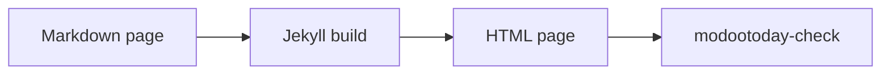

# 数式と図

> [!NOTE]
> このページは[英語の原文](../../../../recipes/figures/math-diagrams/)の翻訳です。内容が異なる場合は英語版が優先されます。

```` ```math ```` や ```` ```mermaid ```` のフェンスは、レンダラーを有効にするまでコードブロックとして表示され、github.com では GitHub が描画します。サイトに表示する方法は三つあります。

| 方法 | 動く環境 | CSP | ブラウザーの JavaScript |
|---|---|---|---|
| [静的な図](#静的な図)：描画した SVG や MathML をコミットする | 従来の GitHub Pages、Jekyll 3.10 と 4、任意のホスト | 厳格なまま、追加なし | なし |
| [組み込みローダー](#組み込みローダー)：`modootoday.mermaid` と `modootoday.math` | 従来の GitHub Pages、Jekyll 3.10 と 4、任意のホスト | 自分でホスト：`'self'`、CDN：CDN のオリジンを追加（下記） | あり、ブロックのあるページだけ |
| `_includes/footer-custom.html` の[独自のローダー](#独自のローダー) | 従来の GitHub Pages、Jekyll 4、任意のホスト | KaTeX は厳格なまま。Mermaid は `style-src 'unsafe-inline'` が必要 | あり |

## 静的な図

推奨の方法です。ページは静的な SVG と MathML を配信するので、JavaScript なしで動き、印刷にも向き、厳格な CSP を通ります。Markdown にはフェンスやブロックがそのまま残るので、github.com と [Markdown 版](../../../guides/agents/)を読むエージェントにはソースが引き続き見えます。

### 静的な Mermaid の図

ページの図を front matter に並べます。ページの最初の ```` ```mermaid ```` フェンスが最初の項目に、2 番目のフェンスが 2 番目の項目に対応します。各フェンスは、コミットした明るい SVG を表示する図になり、ページが暗いとき (訪問者のシステム設定またはテーマの切り替えボタン) は暗い SVG を表示します。

````markdown
---
diagrams:
  - {name: recipes/flow, alt: "Markdown のページが Jekyll のビルドを経て HTML のページになり、modootoday-check がそれを検査します", caption: "ビルドの流れ。", width: 818, height: 63}
---

````

このページも同じ front matter を使っているので、同じフェンスがここではこう表示されます。


- **項目。** `name` は `modootoday.diagrams.dir` の下のファイル名から `.svg` を除いたものです。`recipes/flow` は `/assets/diagrams/recipes/flow.svg` と `/assets/diagrams/recipes/flow.dark.svg` を表示します。`alt` は必須で、「図」ではなく図が示す内容を書きます。`caption` は任意で、インラインの Markdown を使えます。`width` と `height` は SVG のピクセル単位の大きさで、画像の読み込み中も図の場所を確保します。
- **ソースはページに残ります。** フェンスは図の下の「図のソース」という開閉要素に移ります。`source: none` にすると HTML から外れますが、Markdown 版には残ります。
- **ライトとダーク。** どちらの画像にも代替テキストがあります。figure のシート (figure.css) は色のトークンと同じ規則で一方を表示し、もう一方を隠すので、暗い SVG はテーマの切り替えボタンにも従い、隠れた画像は読み上げられません。`dark: false` にすると図ごとの SVG は一つになり、テーマが[画像の図](#画像の図)と同じように暗くします。
- **項目のないフェンス**はコードブロックのまま残ります。`diagrams:` のあるページでは組み込みの Mermaid ローダーは動きません。
- 幅の広い図は狭い画面でも読める幅を保ち、「図」とキャプションを名前とする領域の中で横にスクロールします。代替テキストは画像がすでに伝えるので領域の名前には使わず、この領域は図が段より広いときだけキーボードのフォーカスを受けます。
- `modootoday-check` は、フェンスの数と項目の数が違うページ、`alt` のない項目、見つからない SVG をエラーとして報告します。`width` と `height` のない項目は警告し、SVG の `viewBox` から読んだ値を示します。`data-mt-src` がフェンスと合わなくなった SVG も報告します。[図を最新に保つ](#図を最新に保つ)を参照してください。

```yaml
modootoday:
  diagrams:
    dir: /assets/diagrams/  # SVG を置くサイトのパス (既定値)
    dark: true              # 図ごとに .dark.svg もある (既定値)
    source: details         # details (既定値) または none
```

Mermaid CLI で各フェンスを 2 回描画します。Mermaid の `default` テーマと `dark` テーマ、透明な背景で描き、両方のファイルをコミットします。`flow.mmd` にはフェンスの行の間の内容を入れます。CLI はこのマシンにヘッドレスの Chromium をダウンロードして起動します。リモートのブラウザーと CI は[ブラウザーを動かす場所](#ブラウザーを動かす場所)を参照してください。

```sh
npx -y @mermaid-js/mermaid-cli -i flow.mmd -o assets/diagrams/recipes/flow.svg -t default -b transparent
npx -y @mermaid-js/mermaid-cli -i flow.mmd -o assets/diagrams/recipes/flow.dark.svg -t dark -b transparent
```

SVG をどのフェンスから描いたかを記録するには、ルートの `<svg>` 要素に `data-mt-src="sha256-<hex>"` を付けます。値は、行末を LF にそろえて最後の改行を除いたフェンス本文の SHA-256 です。次のコマンドが `flow.mmd` の値を出力します。

```sh
printf 'sha256-%s\n' "$(printf '%s' "$(tr -d '\r' < flow.mmd)" | sha256sum | cut -d' ' -f1)"
```

Mermaid は各 SVG に `<style>` 要素を書き込みます。ここのように `` で表示すれば、CSP に追加するものはありません。ブラウザーが SVG ファイルを単独で開くと、ホストがそのファイルと一緒に送る CSP ヘッダーが適用されるので、厳格なエッジの CSP から `.svg` ファイルを外すか、SVG の応答だけに `style-src 'unsafe-inline'` を許可してください。

### 図を最新に保つ

SVG のルート要素に `data-mt-src` があれば、`modootoday-check` はその値を、項目が指すフェンスのダイジェストと比べます。フェンスを編集して描き直さなければ、チェックは "stale diagram" で失敗し、ページ、項目、ファイル、フェンスの行を示します。この属性のない SVG は比べないので、手で描いた SVG で失敗することはありません。

`modootoday-check SRC --diagrams` はほかのチェックをせず、描き直す図を JSON で出力し、一つでもあれば 1 で終わります。ビルドが要らないので、pre-commit フックで実行できます。

```json
[
  {
    "page": "recipes/figures/math-diagrams.md",
    "name": "recipes/flow",
    "line": 42,
    "fence": "flowchart LR\n  md[Markdown page] --> build[Jekyll build]\n  build --> html[HTML page]\n  html --> check[modootoday-check]",
    "digest": "sha256-79eaf605a9a879820b538b7f10f67e7232e315b3cabe2d8188e56c3aa675b433",
    "files": {"default": "assets/diagrams/recipes/flow.svg", "dark": "assets/diagrams/recipes/flow.dark.svg"},
    "reason": "stale"
  }
]
```

- `reason` は `missing` (ファイルがまだない) か `stale` (別のフェンスから描いた) です。
- `files` は Mermaid のテーマごとに、書き込むファイルを SRC からのパスで示します。`dark: false` なら `default` だけです。
- `fence` は描画するテキスト、`digest` は `data-mt-src` に入れる値です。

```sh
#!/bin/sh
# .git/hooks/pre-commit
bundle exec modootoday-check . --diagrams > /dev/null && exit 0
echo "Diagram SVGs to render: bundle exec modootoday-check . --diagrams" >&2
exit 1
```

一覧の各フェンスを上のコマンドで `files` に描画し、一覧の `digest` で `data-mt-src` を付けてください。テーマのリポジトリはこれを [`script/figures/diagrams.mjs`](https://github.com/modootoday/jekyll-theme-modootoday/blob/main/script/figures/diagrams.mjs) で行います。このスクリプトは一覧を読み、バージョンを固定した Mermaid で Chromium の中で描画し、属性を書き込みます。gem には含まれません。[`digest.mjs`](https://github.com/modootoday/jekyll-theme-modootoday/blob/main/script/figures/digest.mjs) と一緒に Jekyll が読み飛ばすフォルダー (`_scripts/` など) にコピーすれば、サイトでも同じように使えます (Node と Playwright が必要)。`bundle exec modootoday-check . --diagrams | node _scripts/diagrams.mjs .`

#### ブラウザーを動かす場所

図の描画にはブラウザーが必要です。Mermaid がブラウザーの中で文字を配置するためです。静的な数式は KaTeX が Node 上で動くので、ブラウザーは要りません。`diagrams.mjs`（使い方: `node _scripts/diagrams.mjs SRC [LIST.json] [--cdp=URL]`、`LIST.json` がなければ一覧を標準入力から読みます）は、次のどちらかの方法でブラウザーを使います。

- **このマシンで。** `--cdp` を付けなければ Playwright の Chromium を起動します。`npm install --save-dev playwright` と `npx playwright install chromium` で一度インストールしてください。
- **ほかの場所で。** `--cdp=URL` は、ほかの場所ですでに動いているブラウザーを Chrome DevTools Protocol で操作します。`--remote-debugging-port` を付けて起動した Chrome や Chromium、ブラウザーのコンテナー、ホスティングされたブラウザーサービスのどれでも使えます。`URL` はそのブラウザーの `http://` か `ws://`（`wss://`）のエンドポイントです。エンドポイントが `Authorization` ヘッダーを求める場合は、ヘッダーの値を環境変数 `CDP_AUTHORIZATION` に入れます。ブラウザーのダウンロードは不要で、`playwright` パッケージだけで足ります。リモートのブラウザーは cdn.jsdelivr.net から Mermaid を読み込むので、そのホストに接続できる必要があります。

```sh
export CDP_AUTHORIZATION="Bearer <token>"   # エンドポイントが求めるときだけ
bundle exec modootoday-check . --diagrams > diagrams.json
node _scripts/diagrams.mjs . diagrams.json --cdp=wss://browser.example.com/devtools
```

**CI では**ジョブがブラウザーを自分でインストールします。クラシックの GitHub Pages はコミットされたものしかビルドしないので、CI のジョブは一覧を描画し、リポジトリーの SVG ファイルと違えば失敗して、描画してコミットするよう知らせます。`--diagrams` は描画するものがあると 1 で終了するので、`|| true` を付けます。

```yaml
- run: npm install --save-dev playwright && npx playwright install --with-deps chromium
- run: |
    bundle exec modootoday-check . --diagrams > diagrams.json || true
    node _scripts/diagrams.mjs . diagrams.json
    test -z "$(git status --porcelain -- assets/diagrams)"
```

### 画像の図

どの SVG も普通の図として使え、一つのファイルで両方の配色に対応します。画像として参照し、再生成できるようにソースを隣に置いておきます。

```markdown


*The build flow.*
```

画像だけの段落の後に強調だけの段落が続くと、キャプション付きの図になります。代替テキストには「図」ではなく図の意味を書きます。`.svg` の図は一つのファイルで両方の配色に対応します。ダークモードでは、テーマが色相を保ったまま反転し、`--mt-img-filter-dark` を適用します（トークン `--mt-diagram-filter-dark`）。暗くするだけなら `--mt-diagram-filter-dark: var(--mt-img-filter-dark)`、サイト全体で無効にするなら `none` を設定します。一つの画像だけ描いたままにするには、パスの末尾に `#light` を付けます（`flow.svg#light`）。ラスター画像は従来の写真の色調のままです。狭い画面では、広い図が読める幅（`--mt-figure-min-width`、既定は `32rem`）を保ち、専用の領域の中で横にスクロールします。この領域の名前は「図」とキャプションで、画像がはみ出すときだけフォーカスできます。

### 静的な数式

`mode: static` を設定すると、すべての ```` ```math ```` フェンスと `$$` ブロックが、一度描画してコミットした MathML に置き換わります。MathML はブラウザーが自分で描くので、ページはスクリプトもスタイルシートもフォントも読み込まず、厳格な CSP に追加するものもありません。

```yaml
modootoday:
  math:
    mode: static   # client（既定）は下の組み込みローダーです
```

````markdown
```math
e^{i\pi} + 1 = 0
```

$$
f(x) = a_0 + \sum_{n=1}^{\infty} \left( a_n \cos\frac{n \pi x}{L} + b_n \sin\frac{n \pi x}{L} \right)
$$
````

このサイトは静的な数式を使うので、同じ二つのブロックがここで描画されます。

```math
e^{i\pi} + 1 = 0
```

$$
f(x) = a_0 + \sum_{n=1}^{\infty} \left( a_n \cos\frac{n \pi x}{L} + b_n \sin\frac{n \pi x}{L} \right)
$$

- **MathML の置き場所。** `_data/math/<key>.yml` には、ブロックごとに一つの項目がページの順に並びます。`src` はブロックのダイジェスト（TeX に適用した [`data-mt-src` の規則](#静的な-mermaid-の図)）、`html` はその `<math>` 要素です。`<key>` は拡張子を除いたページのパスで、`/` を `--` と書きます。このページ `recipes/figures/math-diagrams.md` は `_data/math/recipes--figures--math-diagrams.yml` を読みます。翻訳（`math-diagrams.ja.md` や、言語フォルダーの下の同じパス）は英語ページのファイルを読むので、ブロックを同じに保ちます。別のファイルを使うには front matter に `math_key:` を書きます。
- **一つのコマンドで描画。** `modootoday-check SRC --math` は `--diagrams` と同じく、書き出すファイルを JSON で出力し、一つでもあれば 1 で終了するので、pre-commit フックで実行できます。テーマのリポジトリーは、この一覧を [`script/figures/math.mjs`](https://github.com/modootoday/jekyll-theme-modootoday/blob/main/script/figures/math.mjs) で描画します。このスクリプトはブラウザーなしで Node 上の KaTeX を実行します。[`digest.mjs`](https://github.com/modootoday/jekyll-theme-modootoday/blob/main/script/figures/digest.mjs) と一緒に `_scripts/` など Jekyll が読み飛ばすフォルダーにコピーし、`npm install --save-dev katex` と `bundle exec modootoday-check . --math | node _scripts/math.mjs .` を実行します。
- **各数式**は、段より広いときに横へスクロールする領域の中にあります。この領域は数式がはみ出すときにフォーカスでき、ページの言語で「数式 1」「数式 2」のように名前が付きます。MathML は TeX の原文を注釈（annotation）として保持します。
- **インラインの数式は静的にできません。** 静的モードでは `$…$` と、文中の `$$…$$` がエラーになります。数式はブロックで書きます。`inline: true` もエラーです。front matter に `math: false` を書いたページは、ブロックを TeX の原文のまま残します。
- `modootoday-check` は、ブロックの数と項目の数が違うページ、ないファイル、別の TeX から描画した項目（"stale math"）を報告します。
- テーマは、kramdown が行頭に出力する `\[` で `$$` ブロックを見つけます。静的な数式を使うページでは、`\[` で始まるコードブロックの行も数式ブロックと見なされるので、インデントするか文中に移します。

KaTeX は HTML 出力も書けます（`--output=htmlAndMathml`）。どのブラウザーでも同じに見えますが、KaTeX のスタイルシートとフォントが必要で、`style` 属性を使うので CSP に `style-src 'unsafe-inline'` が必要です。`katex` パッケージから `katex.min.css` と `fonts/` をコピーし、`css:`（または下の `base:`）を設定します。テーマは、項目に KaTeX HTML があるページだけでスタイルシートを読み込みます。

## 組み込みローダー

どちらも既定では無効です。`_config.yml` で有効にし、**正確なバージョン**を含むレンダラーの URL とその[サブリソース完全性](https://developer.mozilla.org/ja/docs/Web/Security/Subresource_Integrity)（SRI）ハッシュ、またはサイトに置いたコピーのパスを指定します。

```yaml
modootoday:
  mermaid:
    enabled: true
    src: https://cdn.jsdelivr.net/npm/mermaid@11.4.1/dist/mermaid.min.js
    integrity: sha384-…   # そのファイルの正確なハッシュ
    theme: auto           # auto（ページのライト・ダークに従う）、default、dark、neutral、forest
  math:
    enabled: true
    engine: katex
    src: https://cdn.jsdelivr.net/npm/katex@0.19.0/dist/katex.min.js
    css: https://cdn.jsdelivr.net/npm/katex@0.19.0/dist/katex.min.css
    integrity: {js: sha384-…, css: sha384-…}
    auto_render_src: https://cdn.jsdelivr.net/npm/katex@0.19.0/dist/contrib/auto-render.min.js
    auto_render_integrity: sha384-…
    inline: false
```

- **必要なページだけ。** ブロックのあるページだけでタグを読み込みます。Mermaid は `language-mermaid`、数式は ```` ```math ```` フェンスか `$$` ブロックが対象です。一つのページだけ除くには、front matter に `mermaid: false` か `math: false` を書きます。
- **ハッシュがなければ読み込みません。** `integrity` のない CDN の URL（または https 以外の URL）は何も読み込まず、`modootoday-check` がエラーを報告します。チェッカーは URL に正確なバージョン（`@11` や `@latest` ではなく `@11.4.1`）も求め、ビルドしたページにあるほかの第三者のスクリプトやスタイルシートも報告します。
- **自分でホストできます。** `/assets/vendor/mermaid.min.js` のようなパスはサイトから読み込みます（`relative_url` を適用、`integrity` は任意）。KaTeX は `katex` パッケージから `katex.min.js`、`katex.min.css`、`fonts/` フォルダー、`contrib/auto-render.min.js` を一つのフォルダーにコピーすれば、`base: /assets/vendor/katex/` だけで `src`、`css`、`auto_render_src` を表せます。自分で書いたキーが優先です。
- **JavaScript なしでも読めます。** レンダラーが置き換えるまでソースはコードブロックとして残り、図や数式を解釈できない場合もそのまま残ります。
- **ライトとダーク。** `theme: auto` では、ページがダーク（テーマの切り替えか訪問者のシステム設定）のとき Mermaid の `dark` テーマを使い、変わると描き直します。視差効果を減らす設定では図のアニメーションを止めます。本文より広い図は、キーボードでフォーカスできる専用の領域の中でスクロールします。
- 各ローダーは小さな別のスクリプト（`assets/js/modootoday-mermaid.js`、`assets/js/modootoday-math.js`）で、コアのスクリプトとは別にサイズ予算があります。

### 数式の書き方

```` ```math ```` フェンスか、行を独占する `$$` ブロックを使います。どちらも標準の書き方で、github.com でも描画されます。`$$` ブロックには `auto_render_src` が必要で、ない場合はフェンスだけが描画されます。インラインの `$…$` は `inline: true` のときだけ描画します。そうしないと、ふつうの文の `$`（価格やシェル変数）が数式になってしまうためです。`inline: false` では、`modootoday-check` がページ内のインライン `$…$` に警告します。文中に書いた `$$…$$` は kramdown がインライン数式として出力し、`auto_render_src` があれば描画されます。

### CSP とプライバシー

CDN を使うと、コンテンツセキュリティポリシーと訪問者のプライバシーが変わります。

- **CSP。** CDN のオリジンを `script-src`（両方）、`style-src`（KaTeX のスタイルシート）、`font-src`（KaTeX のフォント）に追加します。Mermaid は各図に `<style>` を書き込むため、どこでホストしても `style-src 'unsafe-inline'` が必要です。自分でホストすれば、スクリプト・スタイル・フォントはすべて `'self'` のままです。[コンテンツセキュリティポリシー](../../csp/)を参照してください。
- **プライバシー。** 訪問者のブラウザーが CDN にファイルを要求するので、CDN は訪問者の IP アドレス、ページのアドレス（リファラー）、時刻を受け取ります。自分でホストすればこれを避けられます。CDN を使う場合は、プライバシーポリシーに記載してください。
- **可用性。** CDN を使うと、その CDN に接続できるときだけブロックが描画され、できないときはソースのコードブロックが残ります。

## 独自のローダー

ビルド手順を追加できないときに使います。レンダラーのファイルをサイトにコピーし、`_includes/footer-custom.html` から読み込みます。タグを Liquid の `if page.math` (または `if page.mermaid`) ブロックで囲み、front matter でそのキーを設定したページだけで読み込むようにします。

### ブラウザーでの KaTeX

```html
<link rel="stylesheet" href="/your-base/assets/katex/katex.min.css">
<script defer src="/your-base/assets/katex/katex.min.js"></script>
<script defer src="/your-base/assets/js/math.js"></script>
```

```js
// assets/js/math.js: render ```math fences (kramdown: pre > code.language-math)
document.querySelectorAll("code.language-math").forEach((code) => {
  const box = document.createElement("div");
  katex.render(code.textContent, box, { displayMode: true, throwOnError: false });
  code.closest("div.highlighter-rouge, pre").replaceWith(box);
});
```

ページの front matter に `math: true` を追加します。スクリプトはファイルなので `script-src 'self'` で足ります。

### ブラウザーでの Mermaid

Mermaid は各 SVG に `<style>` 要素を書き込むため、厳格な `style-src 'self'` ではスタイルがブロックされます。[静的な Mermaid の図](#静的な-mermaid-の図)を使うか、そのページだけインラインスタイルを許可し、スクリプトは厳格なままにします:

```html
<script defer src="/your-base/assets/mermaid/mermaid.min.js"></script>
<script defer src="/your-base/assets/js/diagrams.js"></script>
```

```js
// assets/js/diagrams.js
document.querySelectorAll("code.language-mermaid").forEach((code) => {
  const box = document.createElement("pre");
  box.className = "mermaid";
  box.textContent = code.textContent;
  code.closest("div.highlighter-rouge, pre").replaceWith(box);
});
const dark = document.documentElement.dataset.theme === "dark" || (!document.documentElement.dataset.theme && matchMedia("(prefers-color-scheme: dark)").matches);
mermaid.initialize({ startOnLoad: false, theme: dark ? "dark" : "default", securityLevel: "strict" });
mermaid.run();
```

`securityLevel: "strict"` を保ってください。図の中のクリックハンドラーと HTML ラベルを無効にします。

## チェックリスト

- ソースは Markdown に残るので、github.com と [Markdown 版](../../../guides/agents/)を読むエージェントには引き続き見えます。
- CSP に第三者のオリジンがないこと。または CDN のオリジンを記載し、`integrity` で固定していること。
- すべての図に、何を示すかを述べる代替テキストかキャプションがあること。
- レンダラーは必要なページだけで読み込むこと。
- `modootoday-check SRC --diagrams` の一覧が空であること (コミットした図の SVG がすべて自分のフェンスと合っている)。
- 静的な数式を使うなら、`modootoday-check SRC --math` の一覧も空であること (`_data/math` の項目がすべて自分のブロックと合っている)。
