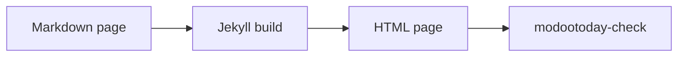

# 수식과 다이어그램

> [!NOTE]
> 이 페이지는 [영어 원문](../../../../recipes/figures/math-diagrams/)의 번역입니다. 내용이 다르면 영어 문서가 우선합니다.

```` ```math ````나 ```` ```mermaid ```` 펜스는 렌더러를 켜기 전까지 코드 블록으로 보이고, github.com에서는 GitHub가 렌더링합니다. 사이트에 보여 주는 방법은 세 가지입니다.

| 방법 | 동작 환경 | CSP | 브라우저 JavaScript |
|---|---|---|---|
| [정적 그림](#정적-그림): 렌더링한 SVG나 MathML을 커밋 | 클래식 GitHub Pages, Jekyll 3.10과 4, 모든 호스트 | 엄격, 추가할 것 없음 | 없음 |
| [내장 로더](../loaders/#내장-로더): `modootoday.mermaid`, `modootoday.math` | 클래식 GitHub Pages, Jekyll 3.10과 4, 모든 호스트 | 직접 호스팅: `'self'`, CDN: CDN 출처 추가(아래 참고) | 있음, 블록이 있는 페이지에서만 |
| `_includes/footer-custom.html`의 [직접 만든 로더](../loaders/#직접-만든-로더) | 클래식 GitHub Pages, Jekyll 4, 모든 호스트 | KaTeX는 엄격 그대로, Mermaid는 `style-src 'unsafe-inline'` 필요 | 있음 |

## 정적 그림

권장하는 방법입니다. 페이지가 정적 SVG와 MathML을 내보내므로 JavaScript 없이 동작하고, 인쇄가 깔끔하며, 엄격한 CSP를 통과합니다. Markdown에는 펜스나 블록이 그대로 남으므로 github.com과 [Markdown 버전](../../../guides/agents/)을 읽는 에이전트도 원본을 볼 수 있습니다.

### 정적 다이어그램

페이지의 다이어그램을 front matter에 나열합니다. 페이지의 첫 번째 ```` ```mermaid ```` 펜스는 첫 번째 항목이 되고, 두 번째 펜스는 두 번째 항목이 되는 식입니다. 각 펜스는 커밋한 밝은 SVG를 보여 주는 그림이 되고, 페이지가 어두울 때(방문자의 시스템 설정이나 테마 전환 버튼)는 어두운 SVG를 보여 줍니다.

````markdown
---
diagrams:
  - {name: recipes/flow, alt: "Markdown 페이지가 Jekyll 빌드를 거쳐 HTML 페이지가 되고, modootoday-check가 이를 검사합니다", caption: "빌드 흐름.", width: 818, height: 63}
---

````

이 페이지도 같은 front matter를 쓰므로, 같은 펜스가 여기서 이렇게 보입니다.


- **항목.** `name`은 `modootoday.diagrams.dir` 아래의 파일 이름에서 `.svg`를 뺀 것입니다. `recipes/flow`는 `/assets/diagrams/recipes/flow.svg`와 `/assets/diagrams/recipes/flow.dark.svg`를 보여 줍니다. `alt`는 필수이며, "다이어그램"이 아니라 다이어그램이 보여 주는 내용을 씁니다. `caption`은 선택이고 인라인 Markdown을 쓸 수 있습니다. `width`와 `height`는 SVG의 픽셀 크기로, 이미지를 불러오는 동안 그림의 자리를 지켜 줍니다.
- **원본은 페이지에 남습니다.** 펜스는 그림 아래의 "다이어그램 원본" 펼침 요소로 옮겨집니다. `source: none`이면 HTML에서 빠지고, Markdown 버전에는 그대로 남습니다.
- **밝은 모드와 다크 모드.** 두 이미지 모두 대체 텍스트가 있습니다. figure 시트(figure.css)는 색상 토큰과 같은 규칙으로 하나를 보여 주고 다른 하나를 숨기므로, 어두운 SVG는 테마 전환 버튼도 따르고 숨긴 이미지는 읽히지 않습니다. `dark: false`이면 다이어그램마다 SVG가 하나이고, 테마가 [이미지 그림](#이미지-그림)처럼 어둡게 바꿉니다.
- **항목이 없는 펜스**는 코드 블록으로 남습니다. `diagrams:`가 있는 페이지에서는 내장 Mermaid 로더가 실행되지 않습니다.
- 넓은 다이어그램은 좁은 화면에서도 읽을 수 있는 너비를 유지하고, "다이어그램"과 캡션을 이름으로 하는 영역 안에서 가로로 스크롤됩니다. 대체 텍스트는 이미지가 이미 전하므로 영역 이름으로 쓰지 않으며, 이 영역은 다이어그램이 단보다 넓을 때만 키보드 포커스를 받습니다.
- `modootoday-check`는 펜스 수와 항목 수가 다른 페이지, `alt`가 없는 항목, 없는 SVG를 오류로 알립니다. `width`와 `height`가 없는 항목은 경고하면서 SVG의 `viewBox`에서 읽은 값을 알려 줍니다. `data-mt-src`가 더 이상 펜스와 맞지 않는 SVG도 알립니다. [다이어그램을 최신으로 유지하기](#다이어그램을-최신으로-유지하기)를 보세요.

```yaml
modootoday:
  diagrams:
    dir: /assets/diagrams/  # SVG가 있는 사이트 경로(기본값)
    dark: true              # 다이어그램마다 .dark.svg도 있음(기본값)
    source: details         # details(기본값) 또는 none
```

Mermaid CLI로 각 펜스를 두 번 렌더링합니다. Mermaid의 `default` 테마와 `dark` 테마, 투명한 배경으로 그린 뒤 두 파일을 모두 커밋합니다. `flow.mmd`에는 펜스 줄 사이의 내용을 담습니다. CLI는 이 컴퓨터에 헤드리스 Chromium을 내려받아 실행합니다. 원격 브라우저와 CI는 [브라우저가 실행되는 곳](#브라우저가-실행되는-곳)을 보세요.

```sh
npx -y @mermaid-js/mermaid-cli -i flow.mmd -o assets/diagrams/recipes/flow.svg -t default -b transparent
npx -y @mermaid-js/mermaid-cli -i flow.mmd -o assets/diagrams/recipes/flow.dark.svg -t dark -b transparent
```

SVG를 어느 펜스에서 그렸는지 기록하려면 루트 `<svg>` 요소에 `data-mt-src="sha256-<hex>"`를 넣습니다. 값은 줄 끝을 LF로 맞추고 마지막 줄바꿈을 뺀 펜스 본문의 SHA-256입니다. 다음 명령이 `flow.mmd`의 값을 출력합니다.

```sh
printf 'sha256-%s\n' "$(printf '%s' "$(tr -d '\r' < flow.mmd)" | sha256sum | cut -d' ' -f1)"
```

Mermaid는 각 SVG에 `<style>` 요소를 써 넣습니다. 여기처럼 ``로 보여 주면 CSP에 추가할 것이 없습니다. 브라우저가 SVG 파일을 따로 열면 호스트가 그 파일과 함께 보내는 CSP 헤더를 적용하므로, 엄격한 엣지 CSP에서 `.svg` 파일을 빼거나 SVG 응답에만 `style-src 'unsafe-inline'`을 허용하세요.

### 다이어그램을 최신으로 유지하기

SVG 루트 요소에 `data-mt-src`가 있으면 `modootoday-check`는 그 값을 항목이 가리키는 펜스의 다이제스트와 비교합니다. 펜스를 고치고 다시 렌더링하지 않으면 검사가 "stale diagram"으로 실패하고, 페이지, 항목, 파일, 펜스의 줄 번호를 알려 줍니다. 이 속성이 없는 SVG는 비교하지 않으므로 직접 그린 SVG로 실패하는 일은 없습니다.

`modootoday-check SRC --diagrams`는 다른 검사는 하지 않고, 렌더링할 다이어그램을 JSON으로 출력하며 하나라도 있으면 1로 끝납니다. 빌드가 필요 없어서 pre-commit 훅에서 실행할 수 있습니다.

```json
[
  {
    "page": "recipes/figures/math-diagrams.md",
    "name": "recipes/flow",
    "line": 42,
    "fence": "flowchart LR\n  md[Markdown page] --> build[Jekyll build]\n  build --> html[HTML page]\n  html --> check[modootoday-check]",
    "digest": "sha256-79eaf605a9a879820b538b7f10f67e7232e315b3cabe2d8188e56c3aa675b433",
    "files": {"default": "assets/diagrams/recipes/flow.svg", "dark": "assets/diagrams/recipes/flow.dark.svg"},
    "reason": "stale"
  }
]
```

- `reason`은 `missing`(파일이 아직 없음) 또는 `stale`(다른 펜스에서 그림)입니다.
- `files`는 Mermaid 테마마다 쓸 파일을 SRC 기준 경로로 알려 줍니다. `dark: false`면 `default`만 있습니다.
- `fence`는 렌더링할 텍스트이고, `digest`는 `data-mt-src`에 넣을 값입니다.

```sh
#!/bin/sh
# .git/hooks/pre-commit
bundle exec modootoday-check . --diagrams > /dev/null && exit 0
echo "Diagram SVGs to render: bundle exec modootoday-check . --diagrams" >&2
exit 1
```

목록의 각 펜스를 위의 명령으로 `files`에 렌더링한 다음, 목록의 `digest`로 `data-mt-src`를 넣으세요. 테마 저장소는 이 과정을 [`script/figures/diagrams.mjs`](https://github.com/modootoday/jekyll-theme-modootoday/blob/main/script/figures/diagrams.mjs)로 처리합니다. 이 스크립트는 목록을 읽고, 버전을 고정한 Mermaid로 Chromium에서 렌더링하고, 속성을 씁니다. gem에는 들어 있지 않습니다. [`digest.mjs`](https://github.com/modootoday/jekyll-theme-modootoday/blob/main/script/figures/digest.mjs)와 함께 Jekyll이 건너뛰는 폴더(예: `_scripts/`)에 복사하면 사이트에서도 같은 방식으로 쓸 수 있습니다(Node와 Playwright 필요). `bundle exec modootoday-check . --diagrams | node _scripts/diagrams.mjs .`

#### 브라우저가 실행되는 곳

다이어그램을 렌더링하려면 브라우저가 필요합니다. Mermaid가 브라우저 안에서 글자를 배치하기 때문입니다. 정적 수식은 KaTeX가 Node에서 실행되므로 브라우저가 필요 없습니다. `diagrams.mjs`(사용법: `node _scripts/diagrams.mjs SRC [LIST.json] [--cdp=URL]`, `LIST.json`이 없으면 목록을 표준 입력에서 읽음)는 두 가지 방법 중 하나로 브라우저를 씁니다.

- **이 컴퓨터에서.** `--cdp`가 없으면 Playwright의 Chromium을 실행합니다. `npm install --save-dev playwright`와 `npx playwright install chromium`으로 한 번 설치하세요.
- **다른 곳에서.** `--cdp=URL`은 다른 곳에서 이미 실행 중인 브라우저를 Chrome DevTools Protocol로 조종합니다. `--remote-debugging-port`로 실행한 Chrome이나 Chromium, 브라우저 컨테이너, 호스팅 브라우저 서비스 모두 됩니다. `URL`은 그 브라우저의 `http://`나 `ws://`(`wss://`) 엔드포인트입니다. 엔드포인트에 `Authorization` 헤더가 필요하면 헤더 값을 `CDP_AUTHORIZATION` 환경 변수에 넣으세요. 브라우저를 내려받을 필요 없이 `playwright` 패키지만 있으면 됩니다. 원격 브라우저는 cdn.jsdelivr.net에서 Mermaid를 불러오므로 그 호스트에 접속할 수 있어야 합니다.

```sh
export CDP_AUTHORIZATION="Bearer <token>"   # 엔드포인트가 요구할 때만
bundle exec modootoday-check . --diagrams > diagrams.json
node _scripts/diagrams.mjs . diagrams.json --cdp=wss://browser.example.com/devtools
```

**CI에서는** 작업이 브라우저를 직접 설치합니다. 클래식 GitHub Pages는 커밋된 파일만 빌드하므로, CI 작업은 목록을 렌더링해 보고 저장소의 SVG 파일과 다르면 실패해서 렌더링하고 커밋하라고 알려 줍니다. `--diagrams`는 렌더링할 것이 있으면 1로 종료하므로 `|| true`를 붙입니다.

```yaml
- run: npm install --save-dev playwright && npx playwright install --with-deps chromium
- run: |
    bundle exec modootoday-check . --diagrams > diagrams.json || true
    node _scripts/diagrams.mjs . diagrams.json
    test -z "$(git status --porcelain -- assets/diagrams)"
```

### 이미지 그림

어떤 SVG든 평범한 그림으로도 쓸 수 있고, 파일 하나로 두 색상 모드에 대응합니다. 이미지로 참조하고, 다시 생성할 수 있도록 원본을 옆에 둡니다.

```markdown


*The build flow.*
```

이미지만 있는 문단 뒤에 강조만 있는 문단이 오면 캡션이 달린 그림이 됩니다. 대체 텍스트에는 "다이어그램"이 아니라 다이어그램의 의미를 쓰세요. `.svg` 그림은 파일 하나로 두 색 구성표에서 모두 동작합니다. 다크 모드에서는 테마가 색상은 유지한 채 반전하고 `--mt-img-filter-dark`를 적용합니다(토큰 `--mt-diagram-filter-dark`). 어둡게만 하려면 `--mt-diagram-filter-dark: var(--mt-img-filter-dark)`, 사이트 전체에서 끄려면 `none`으로 설정하세요. 이미지 하나만 그대로 두려면 경로 끝에 `#light`를 붙입니다(`flow.svg#light`). 래스터 이미지는 기존 사진 톤 그대로입니다. 좁은 화면에서는 넓은 다이어그램이 읽을 수 있는 너비(`--mt-figure-min-width`, 기본 `32rem`)를 유지하고 자체 영역 안에서 가로로 스크롤됩니다. 이 영역의 이름은 "다이어그램"과 캡션이고, 이미지가 넘칠 때만 포커스할 수 있습니다.

### 정적 수식

`mode: static`을 설정하면 모든 ```` ```math ```` 펜스와 `$$` 블록이 한 번 렌더링해 커밋한 MathML로 바뀝니다. MathML은 브라우저가 직접 그리므로 페이지는 스크립트, 스타일시트, 폰트를 하나도 로드하지 않고, 엄격한 CSP에 추가할 것도 없습니다.

```yaml
modootoday:
  math:
    mode: static   # client(기본값)는 아래의 내장 로더입니다
```

````markdown
```math
e^{i\pi} + 1 = 0
```

$$
f(x) = a_0 + \sum_{n=1}^{\infty} \left( a_n \cos\frac{n \pi x}{L} + b_n \sin\frac{n \pi x}{L} \right)
$$
````

이 사이트는 정적 수식을 쓰므로 같은 두 블록이 여기에서 렌더링됩니다.

```math
e^{i\pi} + 1 = 0
```

$$
f(x) = a_0 + \sum_{n=1}^{\infty} \left( a_n \cos\frac{n \pi x}{L} + b_n \sin\frac{n \pi x}{L} \right)
$$

- **MathML이 있는 곳.** `_data/math/<key>.yml`에는 블록마다 항목이 하나씩 페이지 순서대로 있습니다. `src`는 블록의 다이제스트(TeX에 적용한 [`data-mt-src` 규칙](#정적-다이어그램))이고 `html`은 블록의 `<math>` 요소입니다. `<key>`는 확장자를 뺀 페이지 경로에서 `/`를 `--`로 쓴 것입니다. 이 페이지 `recipes/figures/math-diagrams.md`는 `_data/math/recipes--figures--math-diagrams.yml`을 읽습니다. 번역(`math-diagrams.ko.md`나 언어 폴더 아래의 같은 경로)은 영어 페이지의 파일을 읽으므로 블록을 똑같이 유지하세요. 다른 파일을 쓰려면 front matter에 `math_key:`를 지정합니다.
- **명령 하나로 렌더링.** `modootoday-check SRC --math`는 `--diagrams`처럼 써야 할 파일을 JSON으로 출력하고, 하나라도 있으면 1로 종료하므로 pre-commit 훅에서 실행할 수 있습니다. 테마 저장소는 이 목록을 [`script/figures/math.mjs`](https://github.com/modootoday/jekyll-theme-modootoday/blob/main/script/figures/math.mjs)로 렌더링합니다. 이 스크립트는 브라우저 없이 Node에서 KaTeX를 실행합니다. [`digest.mjs`](https://github.com/modootoday/jekyll-theme-modootoday/blob/main/script/figures/digest.mjs)와 함께 `_scripts/`처럼 Jekyll이 건너뛰는 폴더에 복사한 뒤 `npm install --save-dev katex`, `bundle exec modootoday-check . --math | node _scripts/math.mjs .`를 실행합니다.
- **각 수식**은 단보다 넓으면 가로로 스크롤되는 영역 안에 있습니다. 이 영역은 수식이 넘칠 때 포커스할 수 있고 페이지 언어로 "수식 1", "수식 2"처럼 이름이 붙습니다. MathML은 TeX 원문을 주석(annotation)으로 함께 담습니다.
- **인라인 수식은 정적으로 만들 수 없습니다.** 정적 모드에서는 `$…$`와 문장 안의 `$$…$$`가 오류입니다. 수식을 블록으로 쓰세요. `inline: true`도 오류입니다. front matter `math: false`를 지정한 페이지는 블록을 TeX 원문 그대로 둡니다.
- `modootoday-check`는 블록 수와 항목 수가 다른 페이지, 없는 파일, 다른 TeX로 렌더링한 항목("stale math")을 보고합니다.
- 테마는 kramdown이 줄 맨 앞에 출력하는 `\[`로 `$$` 블록을 찾습니다. 정적 수식을 쓰는 페이지에서는 `\[`로 시작하는 코드 블록 줄도 수식 블록으로 잘못 인식되므로, 들여쓰거나 문장 안으로 옮기세요.

KaTeX는 HTML 출력도 만들 수 있습니다(`--output=htmlAndMathml`). 모든 브라우저에서 똑같이 보이지만 KaTeX의 스타일시트와 폰트가 필요하고 `style` 속성을 쓰므로 CSP에 `style-src 'unsafe-inline'`이 필요합니다. `katex` 패키지에서 `katex.min.css`와 `fonts/`를 복사하고 `css:`(또는 아래의 `base:`)를 설정하세요. 테마는 항목에 KaTeX HTML이 있는 페이지에서만 스타일시트를 연결합니다.

내장 로더와 직접 만든 로더는 [다이어그램과 수식 로더](../loaders/)에서 설명합니다.

## 점검 목록

- 원본이 Markdown에 남아 있어 github.com과 [Markdown 버전](../../../guides/agents/)을 읽는 에이전트도 볼 수 있습니다.
- CSP에 제3자 출처가 없거나, CDN 출처를 명시하고 `integrity`로 고정했습니다.
- 모든 다이어그램에 무엇을 보여 주는지 밝히는 대체 텍스트나 캡션이 있습니다.
- 렌더러는 필요한 페이지에서만 불러옵니다.
- `modootoday-check SRC --diagrams`의 목록이 비어 있습니다. 커밋한 다이어그램 SVG가 모두 자기 펜스와 맞습니다.
- 정적 수식을 쓰면 `modootoday-check SRC --math`의 목록도 비어 있습니다. `_data/math`의 항목이 모두 자기 블록과 맞습니다.
