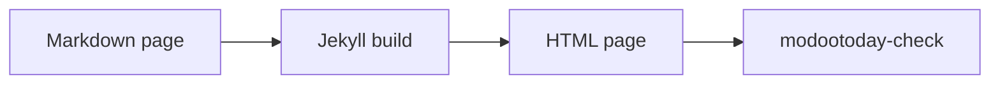

# Math and diagrams

A ```` ```math ```` or ```` ```mermaid ```` fence renders as a code block until you turn a renderer on, and GitHub renders it on github.com. There are three ways to show them on your site:

| Option | Works on | CSP | JavaScript in the browser |
|---|---|---|---|
| [Static figures](#static-figures): commit the rendered SVG or MathML | classic GitHub Pages, Jekyll 3.10 and 4, any host | strict, nothing to add | none |
| [Built-in loaders](../loaders/#built-in-loaders): `modootoday.mermaid` and `modootoday.math` | classic GitHub Pages, Jekyll 3.10 and 4, any host | self-hosted: `'self'`; CDN: add the CDN origin (below) | yes, only on pages with a block |
| [Your own loader](../loaders/#your-own-loader) in `_includes/footer-custom.html` | classic GitHub Pages, Jekyll 4, any host | strict for KaTeX; Mermaid needs `style-src 'unsafe-inline'` | yes |

## Static figures

This is the recommended option. The page ships static SVG and MathML, so it works without JavaScript, prints well and passes a strict CSP. The Markdown keeps the fence or block, so github.com and agents reading the [Markdown twin](../../../guides/agents/) still see the source.

### Static diagrams

List a page's diagrams in front matter. The first ```` ```mermaid ```` fence on the page becomes the first entry, the second fence the second entry, and so on. Each one is shown as a figure with the light SVG you committed, or its dark twin when the page is dark (the visitor's system setting or the theme toggle):

````markdown
---
diagrams:
  - {name: recipes/flow, alt: "A Markdown page goes through the Jekyll build and becomes an HTML page, which modootoday-check then verifies", caption: "The build flow.", width: 818, height: 63}
---

````

This page uses that front matter, so the same fence renders here:


- **Entries.** `name` is the file under `modootoday.diagrams.dir` without `.svg`: `recipes/flow` shows `/assets/diagrams/recipes/flow.svg` and `/assets/diagrams/recipes/flow.dark.svg`. `alt` is required; write what the diagram shows, not "diagram". `caption` is optional and may use inline Markdown. `width` and `height` are the SVG's size in pixels: they keep the figure's space while the image loads.
- **The source stays on the page.** The fence moves under the figure into a "Diagram source" disclosure. `source: none` drops it from the HTML; the Markdown twin still has it.
- **Light and dark.** Both images carry the alt text. The figure sheet shows one and hides the other with the same rules as the color tokens, so the dark one also follows the theme toggle, and a hidden image is not read out. With `dark: false` each diagram has one SVG, which the theme darkens like an [image figure](#image-figures).
- **Fences without an entry** stay code blocks. The built-in Mermaid loader does not run on a page with `diagrams:`.
- A wide diagram keeps a readable width on narrow screens and scrolls sideways inside a region named "Diagram" and the caption, not the alt text that the image already gives; the region takes keyboard focus only while the diagram is wider than the column.
- `modootoday-check` reports a page whose number of fences differs from its number of entries, an entry without `alt`, and a missing SVG. It warns about an entry without `width` and `height` and prints the values from the SVG's `viewBox`. It also reports an SVG whose `data-mt-src` no longer matches its fence; see [Keep diagrams fresh](#keep-diagrams-fresh).

```yaml
modootoday:
  diagrams:
    dir: /assets/diagrams/  # where the SVGs live, a site path (the default)
    dark: true              # each diagram also has a .dark.svg (the default)
    source: details         # details (the default) or none
```

Render each fence twice with the Mermaid CLI, with Mermaid's `default` and `dark` themes and a transparent background, and commit both files. `flow.mmd` holds the lines between the fence lines. The CLI downloads and starts a headless Chromium on this machine; [Where the browser runs](#where-the-browser-runs) has a remote browser and CI:

```sh
npx -y @mermaid-js/mermaid-cli -i flow.mmd -o assets/diagrams/recipes/flow.svg -t default -b transparent
npx -y @mermaid-js/mermaid-cli -i flow.mmd -o assets/diagrams/recipes/flow.dark.svg -t dark -b transparent
```

To record which fence an SVG was drawn from, give its root `<svg>` element `data-mt-src="sha256-<hex>"`: the SHA-256 of the fence body, with line endings as LF and no final newline. This prints the value for `flow.mmd`:

```sh
printf 'sha256-%s\n' "$(printf '%s' "$(tr -d '\r' < flow.mmd)" | sha256sum | cut -d' ' -f1)"
```

Mermaid writes a `<style>` element into each SVG. Shown with ``, as here, it needs nothing from your CSP. A browser that opens the SVG file on its own applies the CSP header your host sends with it, so exempt `.svg` files from a strict edge CSP, or allow `style-src 'unsafe-inline'` for SVG responses only.

### Keep diagrams fresh

When an SVG's root element carries `data-mt-src`, `modootoday-check` compares it with the digest of the fence its entry points to. Edit the fence without rendering it again and the check fails with "stale diagram", naming the page, the entry, the file and the fence's line. An SVG without the attribute is not compared, so a hand-drawn SVG never fails.

`modootoday-check SRC --diagrams` checks nothing else: it prints the diagrams to render as JSON and exits with 1 when there are any. It needs no build, so a pre-commit hook can run it:

```json
[
  {
    "page": "recipes/figures/math-diagrams.md",
    "name": "recipes/flow",
    "line": 42,
    "fence": "flowchart LR\n  md[Markdown page] --> build[Jekyll build]\n  build --> html[HTML page]\n  html --> check[modootoday-check]",
    "digest": "sha256-79eaf605a9a879820b538b7f10f67e7232e315b3cabe2d8188e56c3aa675b433",
    "files": {"default": "assets/diagrams/recipes/flow.svg", "dark": "assets/diagrams/recipes/flow.dark.svg"},
    "reason": "stale"
  }
]
```

- `reason` is `missing` (a file is not there yet) or `stale` (drawn from another fence).
- `files` maps each Mermaid theme to the file to write, relative to SRC. With `dark: false` there is only `default`.
- `fence` is the text to render, and `digest` the value for `data-mt-src`.

```sh
#!/bin/sh
# .git/hooks/pre-commit
bundle exec modootoday-check . --diagrams > /dev/null && exit 0
echo "Diagram SVGs to render: bundle exec modootoday-check . --diagrams" >&2
exit 1
```

Render each listed fence with the commands above into its `files`, then add `data-mt-src` with the listed `digest`. The theme's repository does all of this with [`script/figures/diagrams.mjs`](https://github.com/modootoday/jekyll-theme-modootoday/blob/main/script/figures/diagrams.mjs): it reads the list, renders in Chromium with a pinned Mermaid and writes the attribute. It is not part of the gem; copy it with [`digest.mjs`](https://github.com/modootoday/jekyll-theme-modootoday/blob/main/script/figures/digest.mjs) into a folder Jekyll skips, such as `_scripts/`, to use it the same way in your site (it needs Node and Playwright): `bundle exec modootoday-check . --diagrams | node _scripts/diagrams.mjs .`

#### Where the browser runs

Rendering a diagram needs a browser, because Mermaid lays out its text in one; static math does not, as KaTeX runs in Node. `diagrams.mjs` (usage: `node _scripts/diagrams.mjs SRC [LIST.json] [--cdp=URL]`, the list from stdin without `LIST.json`) gets its browser in one of two ways:

- **On this machine.** Without `--cdp` it starts Playwright's Chromium. Install it once with `npm install --save-dev playwright` and `npx playwright install chromium`.
- **Anywhere else.** `--cdp=URL` drives a browser that already runs elsewhere through the Chrome DevTools Protocol: Chrome or Chromium started with `--remote-debugging-port`, a browser container, or a hosted browser service. `URL` is its `http://` or `ws://` (`wss://`) endpoint. If the endpoint needs an `Authorization` header, put the header's value in the `CDP_AUTHORIZATION` variable. Only the `playwright` package is needed, without a browser download. The remote browser loads Mermaid from cdn.jsdelivr.net, so it must be able to reach that host.

```sh
export CDP_AUTHORIZATION="Bearer <token>"   # only if the endpoint asks for one
bundle exec modootoday-check . --diagrams > diagrams.json
node _scripts/diagrams.mjs . diagrams.json --cdp=wss://browser.example.com/devtools
```

**In CI** the job installs the browser itself. Classic GitHub Pages builds only what is committed, so a CI job renders the list and fails when the SVG files in the repository differ from the renders, which tells you to render and commit them. `--diagrams` exits with 1 whenever there is something to render, hence `|| true`:

```yaml
- run: npm install --save-dev playwright && npx playwright install --with-deps chromium
- run: |
    bundle exec modootoday-check . --diagrams > diagrams.json || true
    node _scripts/diagrams.mjs . diagrams.json
    test -z "$(git status --porcelain -- assets/diagrams)"
```

### Image figures

Any SVG can also be an ordinary figure, one file for both color schemes. Reference it as an image and keep the source next to it so it can be regenerated:

```markdown


*The build flow.*
```

An image-only paragraph followed by an emphasis-only paragraph becomes a figure with a caption. Write the alt text as the diagram's meaning, not "diagram". An `.svg` figure works in both color schemes from one file: in dark mode the theme inverts it with the hues kept, then applies `--mt-img-filter-dark` (the token `--mt-diagram-filter-dark`). Set `--mt-diagram-filter-dark: var(--mt-img-filter-dark)` for a dimmer tone only, or `none` to turn it off for the site; end one image's path in `#light` (`flow.svg#light`) to keep it as drawn. Raster images keep the usual photo tone. On a narrow screen a wide diagram keeps a readable width (`--mt-figure-min-width`, default `32rem`) and scrolls sideways inside its own region, named "Diagram" and the caption and focusable while the image overflows.

### Static math

Set `mode: static` and every ```` ```math ```` fence and `$$` block is replaced by MathML that you render once and commit. Browsers draw MathML themselves, so the page loads no script, stylesheet or font, and a strict CSP needs nothing added:

```yaml
modootoday:
  math:
    mode: static   # client (the default) is the built-in loader below
```

````markdown
```math
e^{i\pi} + 1 = 0
```

$$
f(x) = a_0 + \sum_{n=1}^{\infty} \left( a_n \cos\frac{n \pi x}{L} + b_n \sin\frac{n \pi x}{L} \right)
$$
````

This site uses static math, so the same two blocks render here:

```math
e^{i\pi} + 1 = 0
```

$$
f(x) = a_0 + \sum_{n=1}^{\infty} \left( a_n \cos\frac{n \pi x}{L} + b_n \sin\frac{n \pi x}{L} \right)
$$

- **Where the MathML lives.** `_data/math/<key>.yml` lists one entry per block, in page order: `src` is the block's digest (the [rule of `data-mt-src`](#static-diagrams), over the TeX) and `html` its `<math>` element. `<key>` is the page's path without the extension, with `/` written as `--`: this page, `recipes/figures/math-diagrams.md`, reads `_data/math/recipes--figures--math-diagrams.yml`. A translation (`math-diagrams.ko.md`, or the same path under a language folder) reads its English page's file, so keep its blocks the same. `math_key:` in front matter picks another file.
- **Render with one command.** `modootoday-check SRC --math` prints the files to write as JSON, like `--diagrams`, and exits with 1 when there are any, so a pre-commit hook can run it. The theme's repository renders that list with [`script/figures/math.mjs`](https://github.com/modootoday/jekyll-theme-modootoday/blob/main/script/figures/math.mjs), which runs KaTeX in Node, with no browser. Copy it with [`digest.mjs`](https://github.com/modootoday/jekyll-theme-modootoday/blob/main/script/figures/digest.mjs) into a folder Jekyll skips, such as `_scripts/`, then: `npm install --save-dev katex` and `bundle exec modootoday-check . --math | node _scripts/math.mjs .`
- **Each formula** sits in a region that scrolls sideways when the formula is wider than the column. The region is focusable while the formula overflows, and is named "Formula 1", "Formula 2" and so on, in the page's language. MathML keeps the TeX source as an annotation.
- **Inline math cannot be static.** `$…$`, and `$$…$$` inside a sentence, are errors in static mode: write the formula as a block. `inline: true` is an error too. Front matter `math: false` leaves a page's blocks as TeX source.
- `modootoday-check` reports a page whose number of blocks differs from its number of entries, a missing file, and an entry rendered from other TeX ("stale math").
- The theme finds a `$$` block by the `\[` that kramdown prints at the start of a line. On a page with static math, a code block line that starts with `\[` would be taken for one; indent it or move it into a sentence.

KaTeX can also write its HTML output (`--output=htmlAndMathml`). It looks the same in every browser, but it needs KaTeX's stylesheet and fonts and sets `style` attributes, so your CSP needs `style-src 'unsafe-inline'`. Copy `katex.min.css` and `fonts/` from the `katex` package and set `css:` (or `base:`, below); the theme links the stylesheet only on pages whose entries hold KaTeX HTML.

The built-in loaders and your own loaders are described in [Diagram and math loaders](../loaders/).

## Checklist

- The source stays in the Markdown, so github.com and agents reading the [Markdown twin](../../../guides/agents/) still see it.
- No third-party origins in your CSP, or the CDN origin listed and pinned with `integrity`.
- Every diagram has alt text or a caption that states what it shows.
- Load renderers only on pages that need them.
- `modootoday-check SRC --diagrams` prints an empty list: every committed diagram SVG matches its fence.
- With static math, `modootoday-check SRC --math` prints an empty list too: every entry in `_data/math` matches its block.
