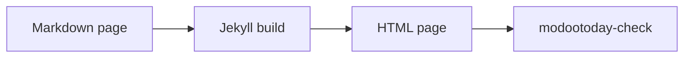

# 수식과 다이어그램

> [!NOTE]
> 이 페이지는 [영어 원문](../../../recipes/math-diagrams/)의 번역입니다. 내용이 다르면 영어 문서가 우선합니다.

```` ```math ````나 ```` ```mermaid ```` 펜스는 렌더러를 켜기 전까지 코드 블록으로 보이고, github.com에서는 GitHub가 렌더링합니다. 사이트에 보여 주는 방법은 세 가지입니다.

| 방법 | 동작 환경 | CSP | 브라우저 JavaScript |
|---|---|---|---|
| [정적 그림](#정적-그림): 렌더링한 SVG를 커밋하고 front matter에 나열 | 클래식 GitHub Pages, Jekyll 3.10과 4, 모든 호스트 | 엄격, 추가할 것 없음 | 없음 |
| [내장 로더](#내장-로더): `modootoday.mermaid`, `modootoday.math` | 클래식 GitHub Pages, Jekyll 3.10과 4, 모든 호스트 | 직접 호스팅: `'self'`, CDN: CDN 출처 추가(아래 참고) | 있음, 블록이 있는 페이지에서만 |
| `_includes/footer-custom.html`의 [직접 만든 로더](#직접-만든-로더) | 클래식 GitHub Pages, Jekyll 4, 모든 호스트 | KaTeX는 엄격 그대로, Mermaid는 `style-src 'unsafe-inline'` 필요 | 있음 |

## 정적 그림

권장하는 방법입니다. 페이지가 정적 SVG를 내보내므로 JavaScript 없이 동작하고, 인쇄가 깔끔하며, 엄격한 CSP를 통과합니다. Markdown에는 펜스가 그대로 남으므로 github.com과 [Markdown 버전](../../guides/agents/)을 읽는 에이전트도 원본을 볼 수 있습니다.

### 정적 다이어그램

페이지의 다이어그램을 front matter에 나열합니다. 페이지의 첫 번째 ```` ```mermaid ```` 펜스는 첫 번째 항목이 되고, 두 번째 펜스는 두 번째 항목이 되는 식입니다. 각 펜스는 커밋한 밝은 SVG를 보여 주는 그림이 되고, 페이지가 어두울 때(방문자의 시스템 설정이나 테마 전환 버튼)는 어두운 SVG를 보여 줍니다.

````markdown
---
diagrams:
  - {name: recipes/flow, alt: "Markdown 페이지가 Jekyll 빌드를 거쳐 HTML 페이지가 되고, modootoday-check가 이를 검사합니다", caption: "빌드 흐름.", width: 818, height: 63}
---

````

이 페이지도 같은 front matter를 쓰므로, 같은 펜스가 여기서 이렇게 보입니다.


- **항목.** `name`은 `modootoday.diagrams.dir` 아래의 파일 이름에서 `.svg`를 뺀 것입니다. `recipes/flow`는 `/assets/diagrams/recipes/flow.svg`와 `/assets/diagrams/recipes/flow.dark.svg`를 보여 줍니다. `alt`는 필수이며, "다이어그램"이 아니라 다이어그램이 보여 주는 내용을 씁니다. `caption`은 선택이고 인라인 Markdown을 쓸 수 있습니다. `width`와 `height`는 SVG의 픽셀 크기로, 이미지를 불러오는 동안 그림의 자리를 지켜 줍니다.
- **원본은 페이지에 남습니다.** 펜스는 그림 아래의 "다이어그램 원본" 펼침 요소로 옮겨집니다. `source: none`이면 HTML에서 빠지고, Markdown 버전에는 그대로 남습니다.
- **밝은 모드와 다크 모드.** 두 이미지 모두 대체 텍스트가 있습니다. figure 시트(figure.css)는 색상 토큰과 같은 규칙으로 하나를 보여 주고 다른 하나를 숨기므로, 어두운 SVG는 테마 전환 버튼도 따르고 숨긴 이미지는 읽히지 않습니다. `dark: false`이면 다이어그램마다 SVG가 하나이고, 테마가 [이미지 그림](#이미지-그림)처럼 어둡게 바꿉니다.
- **항목이 없는 펜스**는 코드 블록으로 남습니다. `diagrams:`가 있는 페이지에서는 내장 Mermaid 로더가 실행되지 않습니다.
- 넓은 다이어그램은 좁은 화면에서도 읽을 수 있는 너비를 유지하고, 대체 텍스트를 이름으로 하는 포커스 가능한 영역 안에서 가로로 스크롤됩니다.
- `modootoday-check`는 펜스 수와 항목 수가 다른 페이지, `alt`가 없는 항목, 없는 SVG를 오류로 알립니다. `width`와 `height`가 없는 항목은 경고하면서 SVG의 `viewBox`에서 읽은 값을 알려 줍니다. `data-mt-src`가 더 이상 펜스와 맞지 않는 SVG도 알립니다. [다이어그램을 최신으로 유지하기](#다이어그램을-최신으로-유지하기)를 보세요.

```yaml
modootoday:
  diagrams:
    dir: /assets/diagrams/  # SVG가 있는 사이트 경로(기본값)
    dark: true              # 다이어그램마다 .dark.svg도 있음(기본값)
    source: details         # details(기본값) 또는 none
```

Mermaid CLI로 각 펜스를 두 번 렌더링합니다. Mermaid의 `default` 테마와 `dark` 테마, 투명한 배경으로 그린 뒤 두 파일을 모두 커밋합니다. `flow.mmd`에는 펜스 줄 사이의 내용을 담습니다.

```sh
npx -y @mermaid-js/mermaid-cli -i flow.mmd -o assets/diagrams/recipes/flow.svg -t default -b transparent
npx -y @mermaid-js/mermaid-cli -i flow.mmd -o assets/diagrams/recipes/flow.dark.svg -t dark -b transparent
```

SVG를 어느 펜스에서 그렸는지 기록하려면 루트 `<svg>` 요소에 `data-mt-src="sha256-<hex>"`를 넣습니다. 값은 줄 끝을 LF로 맞추고 마지막 줄바꿈을 뺀 펜스 본문의 SHA-256입니다. 다음 명령이 `flow.mmd`의 값을 출력합니다.

```sh
printf 'sha256-%s\n' "$(printf '%s' "$(tr -d '\r' < flow.mmd)" | sha256sum | cut -d' ' -f1)"
```

Mermaid는 각 SVG에 `<style>` 요소를 써 넣습니다. 여기처럼 ``로 보여 주면 CSP에 추가할 것이 없습니다. 브라우저가 SVG 파일을 따로 열면 호스트가 그 파일과 함께 보내는 CSP 헤더를 적용하므로, 엄격한 엣지 CSP에서 `.svg` 파일을 빼거나 SVG 응답에만 `style-src 'unsafe-inline'`을 허용하세요.

### 다이어그램을 최신으로 유지하기

SVG 루트 요소에 `data-mt-src`가 있으면 `modootoday-check`는 그 값을 항목이 가리키는 펜스의 다이제스트와 비교합니다. 펜스를 고치고 다시 렌더링하지 않으면 검사가 "stale diagram"으로 실패하고, 페이지, 항목, 파일, 펜스의 줄 번호를 알려 줍니다. 이 속성이 없는 SVG는 비교하지 않으므로 직접 그린 SVG로 실패하는 일은 없습니다.

`modootoday-check SRC --diagrams`는 다른 검사는 하지 않고, 렌더링할 다이어그램을 JSON으로 출력하며 하나라도 있으면 1로 끝납니다. 빌드가 필요 없어서 pre-commit 훅에서 실행할 수 있습니다.

```json
[
  {
    "page": "recipes/math-diagrams.md",
    "name": "recipes/flow",
    "line": 41,
    "fence": "flowchart LR\n  md[Markdown page] --> build[Jekyll build]\n  build --> html[HTML page]\n  html --> check[modootoday-check]",
    "digest": "sha256-79eaf605a9a879820b538b7f10f67e7232e315b3cabe2d8188e56c3aa675b433",
    "files": {"default": "assets/diagrams/recipes/flow.svg", "dark": "assets/diagrams/recipes/flow.dark.svg"},
    "reason": "stale"
  }
]
```

- `reason`은 `missing`(파일이 아직 없음) 또는 `stale`(다른 펜스에서 그림)입니다.
- `files`는 Mermaid 테마마다 쓸 파일을 SRC 기준 경로로 알려 줍니다. `dark: false`면 `default`만 있습니다.
- `fence`는 렌더링할 텍스트이고, `digest`는 `data-mt-src`에 넣을 값입니다.

```sh
#!/bin/sh
# .git/hooks/pre-commit
bundle exec modootoday-check . --diagrams > /dev/null && exit 0
echo "Diagram SVGs to render: bundle exec modootoday-check . --diagrams" >&2
exit 1
```

목록의 각 펜스를 위의 명령으로 `files`에 렌더링한 다음, 목록의 `digest`로 `data-mt-src`를 넣으세요. 테마 저장소는 이 과정을 [`script/figures/diagrams.mjs`](https://github.com/modootoday/jekyll-theme-modootoday/blob/main/script/figures/diagrams.mjs)로 처리합니다. 이 스크립트는 목록을 읽고, 버전을 고정한 Mermaid로 Chromium에서 렌더링하고, 속성을 씁니다. gem에는 들어 있지 않습니다. `digest.mjs`와 함께 Jekyll이 건너뛰는 폴더(예: `_scripts/`)에 복사하면 사이트에서도 같은 방식으로 쓸 수 있습니다(Node와 Playwright 필요). `bundle exec modootoday-check . --diagrams | node _scripts/diagrams.mjs .`

### 이미지 그림

어떤 SVG든 평범한 그림으로도 쓸 수 있고, 파일 하나로 두 색상 모드에 대응합니다. 이미지로 참조하고, 다시 생성할 수 있도록 원본을 옆에 둡니다.

```markdown


*The build flow.*
```

이미지만 있는 문단 뒤에 강조만 있는 문단이 오면 캡션이 달린 그림이 됩니다. 대체 텍스트에는 "다이어그램"이 아니라 다이어그램의 의미를 쓰세요. `.svg` 그림은 파일 하나로 두 색 구성표에서 모두 동작합니다. 다크 모드에서는 테마가 색상은 유지한 채 반전하고 `--mt-img-filter-dark`를 적용합니다(토큰 `--mt-diagram-filter-dark`). 어둡게만 하려면 `--mt-diagram-filter-dark: var(--mt-img-filter-dark)`, 사이트 전체에서 끄려면 `none`으로 설정하세요. 이미지 하나만 그대로 두려면 경로 끝에 `#light`를 붙입니다(`flow.svg#light`). 래스터 이미지는 기존 사진 톤 그대로입니다. 좁은 화면에서는 넓은 다이어그램이 읽을 수 있는 너비(`--mt-figure-min-width`, 기본 `32rem`)를 유지하고 자체 영역 안에서 가로로 스크롤됩니다. 이 영역은 포커스할 수 있고 대체 텍스트가 이름이 됩니다.

### 수식

커밋 전에 실행하는 스크립트나 GitHub Actions의 Jekyll 4 빌드에서 KaTeX로 수식을 한 번 HTML로 렌더링합니다. 그다음 KaTeX의 CSS와 폰트를 사이트에서 직접 제공합니다. 예시의 `/your-base`는 사이트의 `baseurl`로 바꾸세요(또는 Jekyll의 `relative_url` 필터를 쓰세요).

```sh
npm install katex
mkdir -p assets/katex && cp -r node_modules/katex/dist/katex.min.css node_modules/katex/dist/fonts assets/katex/
```

```html
<!-- _includes/head-custom.html -->
<link rel="stylesheet" href="/your-base/assets/katex/katex.min.css">
```

KaTeX의 정적 출력은 일반 HTML과 CSS 클래스이므로 `style-src 'self'`로 충분합니다.

## 내장 로더

둘 다 기본으로 꺼져 있습니다. `_config.yml`에서 켜고, **정확한 버전**을 담은 렌더러 URL과 그 [하위 리소스 무결성](https://developer.mozilla.org/ko/docs/Web/Security/Subresource_Integrity)(SRI) 해시를 지정하거나, 사이트에 둔 사본의 경로를 지정합니다.

```yaml
modootoday:
  mermaid:
    enabled: true
    src: https://cdn.jsdelivr.net/npm/mermaid@11.4.1/dist/mermaid.min.js
    integrity: sha384-…   # 그 파일의 정확한 해시
    theme: auto           # auto(페이지의 라이트·다크 모드를 따름), default, dark, neutral, forest
  math:
    enabled: true
    engine: katex
    src: https://cdn.jsdelivr.net/npm/katex@0.16.11/dist/katex.min.js
    css: https://cdn.jsdelivr.net/npm/katex@0.16.11/dist/katex.min.css
    integrity: {js: sha384-…, css: sha384-…}
    auto_render_src: https://cdn.jsdelivr.net/npm/katex@0.16.11/dist/contrib/auto-render.min.js
    auto_render_integrity: sha384-…
    inline: false
```

- **필요한 곳에서만.** 블록이 있는 페이지에서만 태그를 로드합니다. Mermaid는 `language-mermaid`, 수식은 ```` ```math ```` 펜스나 `$$` 블록이 기준입니다. 한 페이지만 빼려면 front matter에 `mermaid: false`나 `math: false`를 넣습니다.
- **해시가 없으면 로드하지 않습니다.** `integrity`가 없는 CDN URL(또는 https가 아닌 URL)은 아무것도 로드하지 않고, `modootoday-check`가 오류를 보고합니다. 검사기는 URL에 정확한 버전(`@11`이나 `@latest`가 아닌 `@11.4.1`)도 요구하며, 빌드된 페이지의 다른 제3자 스크립트·스타일시트도 보고합니다.
- **직접 호스팅.** `/assets/vendor/mermaid.min.js` 같은 경로는 사이트에서 로드합니다(`relative_url` 적용, `integrity`는 선택). KaTeX는 `katex` 패키지에서 `katex.min.js`, `katex.min.css`, `fonts/` 폴더, `contrib/auto-render.min.js`를 복사합니다.
- **JavaScript 없이도 읽을 수 있습니다.** 렌더러가 바꾸기 전까지 소스가 코드 블록으로 남고, 다이어그램이나 수식을 해석하지 못하면 그대로 남습니다.
- **라이트와 다크.** `theme: auto`면 페이지가 다크일 때(테마 토글이나 방문자의 시스템 설정) Mermaid의 `dark` 테마를 쓰고, 바뀌면 다시 그립니다. 동작 줄이기를 요청하면 다이어그램 애니메이션을 끕니다. 본문보다 넓은 다이어그램은 키보드로 포커스할 수 있는 자체 영역 안에서 스크롤됩니다.
- 각 로더는 별도의 작은 스크립트(`assets/js/modootoday-mermaid.js`, `assets/js/modootoday-math.js`)이고, 코어 스크립트와 별도의 크기 예산이 있습니다.

### 수식 표기

```` ```math ```` 펜스나 한 줄을 차지하는 `$$` 블록을 쓰세요. 둘 다 표준 표기이며 github.com에서도 렌더링됩니다. `$$` 블록에는 `auto_render_src`가 필요하고, 없으면 펜스만 렌더링합니다. 인라인 `$…$`는 `inline: true`일 때만 렌더링합니다. 그렇지 않으면 일반 문장의 `$`(가격, 셸 변수)가 수식으로 바뀌기 때문입니다. `inline: false`면 `modootoday-check`가 페이지의 인라인 `$…$`에 경고합니다. 문장 안에 쓴 `$$…$$`는 kramdown이 인라인 수식으로 출력하며, `auto_render_src`가 있으면 렌더링됩니다.

### CSP와 개인정보

CDN을 쓰면 콘텐츠 보안 정책과 방문자 개인정보가 달라집니다.

- **CSP.** CDN 출처를 `script-src`(둘 다), `style-src`(KaTeX 스타일시트), `font-src`(KaTeX 글꼴)에 추가합니다. Mermaid는 각 다이어그램에 `<style>`을 쓰므로 어디서 호스팅하든 `style-src 'unsafe-inline'`이 필요합니다. 직접 호스팅하면 스크립트·스타일·글꼴 모두 `'self'`로 유지됩니다. [콘텐츠 보안 정책](../csp/)을 참고하세요.
- **개인정보.** 방문자의 브라우저가 CDN에 파일을 요청하므로, CDN은 방문자의 IP 주소, 페이지 주소(리퍼러), 시각을 받습니다. 직접 호스팅하면 이를 피할 수 있습니다. CDN을 쓴다면 개인정보 처리방침에 밝히세요.
- **가용성.** CDN을 쓰면 그 CDN에 접속할 수 있을 때만 블록이 렌더링되고, 아니면 소스 코드 블록이 남습니다.

## 직접 만든 로더

빌드 단계를 추가할 수 없을 때 씁니다. 렌더러 파일을 사이트에 복사하고 `_includes/footer-custom.html`에서 불러옵니다. 태그를 Liquid `if page.math`(또는 `if page.mermaid`) 블록으로 감싸서 front matter에 그 키를 둔 페이지에서만 로드되게 하세요.

### 브라우저에서 KaTeX

```html
<link rel="stylesheet" href="/your-base/assets/katex/katex.min.css">
<script defer src="/your-base/assets/katex/katex.min.js"></script>
<script defer src="/your-base/assets/js/math.js"></script>
```

```js
// assets/js/math.js: render ```math fences (kramdown: pre > code.language-math)
document.querySelectorAll("code.language-math").forEach((code) => {
  const box = document.createElement("div");
  katex.render(code.textContent, box, { displayMode: true, throwOnError: false });
  code.closest("div.highlighter-rouge, pre").replaceWith(box);
});
```

페이지 front matter에 `math: true`를 추가합니다. 스크립트가 파일이므로 `script-src 'self'`로 충분합니다.

### 브라우저에서 Mermaid

Mermaid는 각 SVG에 `<style>` 요소를 써 넣으므로 엄격한 `style-src 'self'`에서는 스타일이 막힙니다. [정적 다이어그램](#정적-다이어그램)을 쓰거나, 해당 페이지에서만 인라인 스타일을 허용하고 스크립트는 엄격하게 유지하세요.

```html
<script defer src="/your-base/assets/mermaid/mermaid.min.js"></script>
<script defer src="/your-base/assets/js/diagrams.js"></script>
```

```js
// assets/js/diagrams.js
document.querySelectorAll("code.language-mermaid").forEach((code) => {
  const box = document.createElement("pre");
  box.className = "mermaid";
  box.textContent = code.textContent;
  code.closest("div.highlighter-rouge, pre").replaceWith(box);
});
const dark = document.documentElement.dataset.theme === "dark" || (!document.documentElement.dataset.theme && matchMedia("(prefers-color-scheme: dark)").matches);
mermaid.initialize({ startOnLoad: false, theme: dark ? "dark" : "default", securityLevel: "strict" });
mermaid.run();
```

`securityLevel: "strict"`를 유지하세요. 다이어그램 안의 클릭 핸들러와 HTML 레이블을 끕니다.

## 점검 목록

- 원본이 Markdown에 남아 있어 github.com과 [Markdown 버전](../../guides/agents/)을 읽는 에이전트도 볼 수 있습니다.
- CSP에 제3자 출처가 없거나, CDN 출처를 명시하고 `integrity`로 고정했습니다.
- 모든 다이어그램에 무엇을 보여 주는지 밝히는 대체 텍스트나 캡션이 있습니다.
- 렌더러는 필요한 페이지에서만 불러옵니다.
- `modootoday-check SRC --diagrams`의 목록이 비어 있습니다. 커밋한 다이어그램 SVG가 모두 자기 펜스와 맞습니다.
