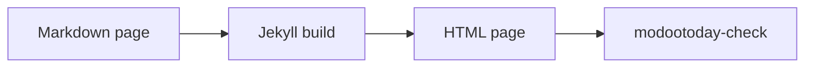

# Math and diagrams

A ```` ```math ```` or ```` ```mermaid ```` fence renders as a code block until you turn a renderer on, and GitHub renders it on github.com. There are three ways to show them on your site:

| Option | Works on | CSP | JavaScript in the browser |
|---|---|---|---|
| [Static figures](#static-figures): commit the rendered SVG and list it in front matter | classic GitHub Pages, Jekyll 3.10 and 4, any host | strict, nothing to add | none |
| [Built-in loaders](#built-in-loaders): `modootoday.mermaid` and `modootoday.math` | classic GitHub Pages, Jekyll 3.10 and 4, any host | self-hosted: `'self'`; CDN: add the CDN origin (below) | yes, only on pages with a block |
| [Your own loader](#your-own-loader) in `_includes/footer-custom.html` | classic GitHub Pages, Jekyll 4, any host | strict for KaTeX; Mermaid needs `style-src 'unsafe-inline'` | yes |

## Static figures

This is the recommended option. The page ships static SVG, so it works without JavaScript, prints well and passes a strict CSP. The Markdown keeps the fence, so github.com and agents reading the [Markdown twin](../../guides/agents/) still see the source.

### Static diagrams

List a page's diagrams in front matter. The first ```` ```mermaid ```` fence on the page becomes the first entry, the second fence the second entry, and so on. Each one is shown as a figure with the light SVG you committed, or its dark twin when the page is dark (the visitor's system setting or the theme toggle):

````markdown
---
diagrams:
  - {name: recipes/flow, alt: "A Markdown page goes through the Jekyll build and becomes an HTML page, which modootoday-check then verifies", caption: "The build flow.", width: 818, height: 63}
---

````

This page uses that front matter, so the same fence renders here:


- **Entries.** `name` is the file under `modootoday.diagrams.dir` without `.svg`: `recipes/flow` shows `/assets/diagrams/recipes/flow.svg` and `/assets/diagrams/recipes/flow.dark.svg`. `alt` is required; write what the diagram shows, not "diagram". `caption` is optional and may use inline Markdown. `width` and `height` are the SVG's size in pixels: they keep the figure's space while the image loads.
- **The source stays on the page.** The fence moves under the figure into a "Diagram source" disclosure. `source: none` drops it from the HTML; the Markdown twin still has it.
- **Light and dark.** Both images carry the alt text. The figure sheet shows one and hides the other with the same rules as the colour tokens, so the dark one also follows the theme toggle, and a hidden image is not read out. With `dark: false` each diagram has one SVG, which the theme darkens like an [image figure](#image-figures).
- **Fences without an entry** stay code blocks. The built-in Mermaid loader does not run on a page with `diagrams:`.
- A wide diagram keeps a readable width on narrow screens and scrolls sideways inside a focusable region named by the alt text.
- `modootoday-check` reports a page whose number of fences differs from its number of entries, an entry without `alt`, and a missing SVG. It warns about an entry without `width` and `height` and prints the values from the SVG's `viewBox`.

```yaml
modootoday:
  diagrams:
    dir: /assets/diagrams/  # where the SVGs live, a site path (the default)
    dark: true              # each diagram also has a .dark.svg (the default)
    source: details         # details (the default) or none
```

Render each fence twice with the Mermaid CLI, with Mermaid's `default` and `dark` themes and a transparent background, and commit both files. `flow.mmd` holds the lines between the fence lines:

```sh
npx -y @mermaid-js/mermaid-cli -i flow.mmd -o assets/diagrams/recipes/flow.svg -t default -b transparent
npx -y @mermaid-js/mermaid-cli -i flow.mmd -o assets/diagrams/recipes/flow.dark.svg -t dark -b transparent
```

To record which fence an SVG was drawn from, give its root `<svg>` element `data-mt-src="sha256-<hex>"`: the SHA-256 of the fence body, with line endings as LF and no final newline. This prints the value for `flow.mmd`:

```sh
printf 'sha256-%s\n' "$(printf '%s' "$(tr -d '\r' < flow.mmd)" | sha256sum | cut -d' ' -f1)"
```

Mermaid writes a `<style>` element into each SVG. Shown with ``, as here, it needs nothing from your CSP. A browser that opens the SVG file on its own applies the CSP header your host sends with it, so exempt `.svg` files from a strict edge CSP, or allow `style-src 'unsafe-inline'` for SVG responses only.

### Image figures

Any SVG can also be an ordinary figure, one file for both colour schemes. Reference it as an image and keep the source next to it so it can be regenerated:

```markdown


*The build flow.*
```

An image-only paragraph followed by an emphasis-only paragraph becomes a figure with a caption. Write the alt text as the diagram's meaning, not "diagram". An `.svg` figure works in both colour schemes from one file: in dark mode the theme inverts it with the hues kept, then applies `--mt-img-filter-dark` (the token `--mt-diagram-filter-dark`). Set `--mt-diagram-filter-dark: var(--mt-img-filter-dark)` for a dimmer tone only, or `none` to turn it off for the site; end one image's path in `#light` (`flow.svg#light`) to keep it as drawn. Raster images keep the usual photo tone. On a narrow screen a wide diagram keeps a readable width (`--mt-figure-min-width`, default `32rem`) and scrolls sideways inside its own region, which is focusable and named by the alt text.

### Math

Render formulas to HTML with KaTeX once, in a script you run before committing, or in a Jekyll 4 build on GitHub Actions. Then serve KaTeX's CSS and fonts from your own site. In the examples, replace `/your-base` with your site's `baseurl` (or use Jekyll's `relative_url` filter):

```sh
npm install katex
mkdir -p assets/katex && cp -r node_modules/katex/dist/katex.min.css node_modules/katex/dist/fonts assets/katex/
```

```html
<!-- _includes/head-custom.html -->
<link rel="stylesheet" href="/your-base/assets/katex/katex.min.css">
```

KaTeX's static output is plain HTML and CSS classes, so `style-src 'self'` is enough.

## Built-in loaders

Both are off by default. Turn one on in `_config.yml` with a URL to a renderer **at an exact version** and its [Subresource Integrity](https://developer.mozilla.org/en-US/docs/Web/Security/Subresource_Integrity) hash, or with a path to a copy on your own site:

```yaml
modootoday:
  mermaid:
    enabled: true
    src: https://cdn.jsdelivr.net/npm/mermaid@11.4.1/dist/mermaid.min.js
    integrity: sha384-…   # the hash of that exact file
    theme: auto           # auto (follows the page's light or dark mode), default, dark, neutral, forest
  math:
    enabled: true
    engine: katex
    src: https://cdn.jsdelivr.net/npm/katex@0.16.11/dist/katex.min.js
    css: https://cdn.jsdelivr.net/npm/katex@0.16.11/dist/katex.min.css
    integrity: {js: sha384-…, css: sha384-…}
    auto_render_src: https://cdn.jsdelivr.net/npm/katex@0.16.11/dist/contrib/auto-render.min.js
    auto_render_integrity: sha384-…
    inline: false
```

- **Only where needed.** The tags load only on pages that contain a block: `language-mermaid` for Mermaid, a ```` ```math ```` fence or a `$$` block for math. Set `mermaid: false` or `math: false` in a page's front matter to skip one page.
- **No hash, no load.** A CDN URL without `integrity` (or a non-https URL) loads nothing, and `modootoday-check` reports an error. The checker also requires an exact version in the URL (`@11.4.1`, not `@11` or `@latest`) and reports any other third-party script or stylesheet in the built pages.
- **Self-hosted.** A path such as `/assets/vendor/mermaid.min.js` loads from your own site (`relative_url` is applied; `integrity` is optional). For KaTeX, copy `katex.min.js`, `katex.min.css`, the `fonts/` folder and `contrib/auto-render.min.js` from the `katex` package.
- **Readable without JavaScript.** The source stays on the page as a code block until the renderer replaces it, and stays if a diagram or formula fails to parse.
- **Light and dark.** With `theme: auto`, diagrams use Mermaid's `dark` theme when the page is dark (the theme toggle or the visitor's system setting) and redraw when it changes. With reduced motion requested, diagram animations are off. A diagram wider than the column scrolls inside its own keyboard-focusable region.
- Each loader is a small separate script (`assets/js/modootoday-mermaid.js`, `assets/js/modootoday-math.js`) with its own size budget, not part of the core script.

### Math notation

Use a ```` ```math ```` fence or a `$$` block on its own lines; both are the standard notation and render on github.com too. A `$$` block needs `auto_render_src`; without it only fences render. Inline `$…$` renders only with `inline: true`, because a `$` in ordinary prose (prices, shell variables) would otherwise turn into math. With `inline: false`, `modootoday-check` warns about inline `$…$` in your pages. kramdown prints `$$…$$` written inside a sentence as inline math, which renders whenever `auto_render_src` is set.

### CSP and privacy

A CDN changes your Content Security Policy and your visitors' privacy:

- **CSP.** Add the CDN origin to `script-src` (both), to `style-src` (KaTeX's stylesheet) and to `font-src` (KaTeX's fonts). Mermaid also writes `<style>` into each diagram, so it needs `style-src 'unsafe-inline'` wherever you host it. A self-hosted copy keeps `'self'` for scripts, styles and fonts. See [Content Security Policy](../csp/).
- **Privacy.** Each visitor's browser requests the files from the CDN, so the CDN receives the visitor's IP address, the page address (as referrer) and the time. Self-hosting avoids this; mention the CDN in your privacy notice if you use one.
- **Availability.** With a CDN, the blocks render only while that CDN is reachable; the source code block remains otherwise.

## Your own loader

Use this when you need control the built-in loaders do not give. Copy the renderer's files into your site, then load them from `_includes/footer-custom.html`. Wrap the tags in a Liquid `if page.math` (or `if page.mermaid`) block so they load only on pages that set that key in front matter.

### KaTeX in the browser

```html
<link rel="stylesheet" href="/your-base/assets/katex/katex.min.css">
<script defer src="/your-base/assets/katex/katex.min.js"></script>
<script defer src="/your-base/assets/js/math.js"></script>
```

```js
// assets/js/math.js: render ```math fences (kramdown: pre > code.language-math)
document.querySelectorAll("code.language-math").forEach((code) => {
  const box = document.createElement("div");
  katex.render(code.textContent, box, { displayMode: true, throwOnError: false });
  code.closest("div.highlighter-rouge, pre").replaceWith(box);
});
```

Add `math: true` to the page's front matter. The script is a file, so `script-src 'self'` is enough.

### Mermaid in the browser

Mermaid writes `<style>` elements into each SVG, so a strict `style-src 'self'` blocks its styling. Either use [static diagrams](#static-diagrams), or allow inline styles for that page only and keep scripts strict:

```html
<script defer src="/your-base/assets/mermaid/mermaid.min.js"></script>
<script defer src="/your-base/assets/js/diagrams.js"></script>
```

```js
// assets/js/diagrams.js
document.querySelectorAll("code.language-mermaid").forEach((code) => {
  const box = document.createElement("pre");
  box.className = "mermaid";
  box.textContent = code.textContent;
  code.closest("div.highlighter-rouge, pre").replaceWith(box);
});
const dark = document.documentElement.dataset.theme === "dark" || (!document.documentElement.dataset.theme && matchMedia("(prefers-color-scheme: dark)").matches);
mermaid.initialize({ startOnLoad: false, theme: dark ? "dark" : "default", securityLevel: "strict" });
mermaid.run();
```

Keep `securityLevel: "strict"`: it disables click handlers and HTML labels inside diagrams.

## Checklist

- The source stays in the Markdown, so github.com and agents reading the [Markdown twin](../../guides/agents/) still see it.
- No third-party origins in your CSP, or the CDN origin listed and pinned with `integrity`.
- Every diagram has alt text or a caption that states what it shows.
- Load renderers only on pages that need them.
